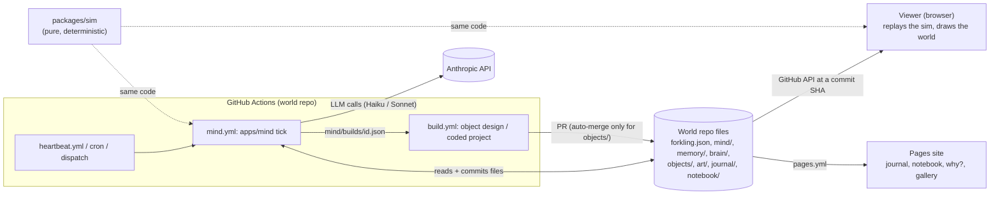

# How Forkling works

A guide to how the parts connect. It explains; it does not judge. What looks wrong or unintended is in [`review-2026-11.md`](review-2026-11.md). The intent behind the design is in [`architecture.md`](architecture.md) and [`decisions.md`](decisions.md).

Facts here come from reading the code (paths and line numbers as of v0.7.3 plus the `split-tick` refactor) and from the live Merge repo on 2026-11-01. Where a number is my own arithmetic rather than something observed, it says "estimate".

## 1. One picture



Three facts about this picture drive most of what follows.

1. **The repo is the only shared memory.** The mind, the viewer, the builder and the site never talk to each other. They read and write files.
2. **The sim code runs in two places.** The mind replays the body in Node to learn where Merge is and how its needs stand. The viewer replays it in the browser to draw it. Both start from `forkling.json`, but they do not necessarily start from the same moment (section 5).
3. **The LLM is rare.** It runs only when a surprise trigger fires (section 4). In between, a utility AI (`packages/sim/src/utility.ts`) picks what the body does.

## 2. A day in Merge's life, traced through the code

Times are Merge's (Europe/Stockholm). The step names are modules in `apps/mind/src/tick/`.

| When | What happens | Code |
|---|---|---|
| Every 10 min | A tick starts. In practice the optional heartbeat workflow is the clock; the GitHub cron fires rarely. While asleep the gate lets only the tick in minute `:03` through | `templates/forkling-world/.github/workflows/mind.yml` (gate at lines 40-56), `heartbeat.yml` |
| Tick start | Load the world, roll temperament if new, replay the body up to now, roll the budget month | `tick/create.ts` |
| First awake tick of the day (up to about an hour after 07:00) | `newDay` trigger. Morning skim of 7 feeds, then one Haiku call writes today's plan (up to 12 steps) and may set or keep the long goal | `tick/reading.ts`, `tick/think.ts`, `prompts/morning.ts` |
| Through the day | A plan step has a `minutes` value. When its time is up, `stepDone` fires. If steps remain and nothing else fired (or the model cannot be asked), the next step starts with no LLM call. When the last step ends, or the day is planned and nothing is running, a `replan` trigger asks Haiku for the next plan (not in the last 45 minutes before bed, and not again for an hour after an empty or rejected answer) | `tick/route.ts`, `tick/advance.ts` |
| When a step ends | Its effect lands on the world (gathered, made, ate) and skill XP is added (the minutes really spent), but only if the replayed body spent at least 60% of the step's minutes on its verb. A step that fell short is given its time again once, then ends unfinished with nothing gathered, made or learned. Side calls queue: art, reading, photo, code | `tick/apply-step.ts` |
| Any time | Something new, a blocked step or a need under 15 fires a trigger and Haiku decides | `packages/sim/src/surprise.ts` |
| Around 22:30 | `bedtime` trigger. Sonnet writes the journal and updates beliefs. Code drops paragraphs that cite nothing real | `tick/bedtime.ts`, `reflect.ts`, `packages/sim/src/claims.ts` |
| Asleep | No triggers. Once the evening is reflected, one Batch job rewrites the 12 memory slots | `tick/memory.ts` |
| Weekly | If the long goal was last reviewed 7 or more days ago, Sonnet reviews it | `prompts/weekly.ts` |
| After each tick | The workflow commits changed files, dispatches `pages.yml` for some changes and `build.yml` if a build was requested | `mind.yml` |

## 3. The tick, step by step

`apps/mind/src/tick.ts` calls these in order on a shared `Tick` object (`tick/context.ts`).

| # | Step | Does | Runs when |
|---|---|---|---|
| 0 | `create` | Reads all files, replays the body to now (needs, position), builds the cached system prompt | always |
| 1 | `settleBuild` | Notices that a requested build arrived, or gives up after 72 hours | a build is open |
| 2 | `finishStep` | Scores surprise, then lands the effect and XP of a step whose time is up | `stepDone` fired and awake |
| 3 | `route` | If the only trigger is `stepDone` and steps remain, starts the next step free. Otherwise picks the think kind: newDay, then bedtime, then weekly, else decide | always |
| 4 | `readStep` | Morning feed skim, or one topic reading session | morning, or a read/study step finished |
| 5 | `artStep` | One Haiku call makes an artifact in `art/` | a creative step finished, under 4 a day |
| 6 | `codeStep` | Haiku writes a project brief to `mind/builds/` | a code step finished and a slot is free |
| 7 | `photoStep` | Queues eye-cam shots (no LLM here; vision runs after the tick) | a photograph step finished, or novelty |
| 8 | `think` | The main Haiku or Sonnet call. One retry if the plan fails validation | think kind is morning, decide or weekly |
| 9 | `bedtime` | Sonnet reflection, journal, belief changes | think kind is bedtime |
| 10 | `memoryStep` | Submits or polls the nightly Batch job | asleep and reflected, or a batch is pending |
| 11 | `applyDecision` | Turns the decision into goals, a build request, a late night, or a rejected plan (a rejected replacement leaves today's plan alone) | a decision exists |
| 11b | `advance` | A step that ran out hands over to the next, or leaves the body free, whether or not the model answered; a blocked step that was answered with "carry on" is skipped | always |
| 12 | `feel` | Updates mood from the events of this tick | always |
| 13 | `write` | Writes files, stream and timeline entries, prunes old stream. The time the body spent on the step and what broke it off are written only when something else is | always (a quiet tick writes no world file) |
| 14 | `logTick` | One line in `mind/ticks/` and a fresh `mind/health.json`, even for a tick that changed nothing | always (not on a dry run) |

## 4. Every LLM call

Everything in the tick goes through one gate, `makeAsk` (`tick/ask.ts`), which checks the budget and uses structured output.

| Call | Model | Trigger | Output | What code does with it |
|---|---|---|---|---|
| morning | Haiku | `newDay` | `Decision` | Validate plan (one retry), write `mind/goals.json`, `notebook/plans/` |
| decide | Haiku | novelty, blocked, need, or `stepDone` with no steps left | `Decision` | Same |
| weekly | Sonnet | long goal 7+ days since review | `Decision` | Keep, change or drop the long goal |
| bedtime | Sonnet | within 30 min of bed, evening not reflected | `Reflection` | Drop unsupported paragraphs, write `journal/`, change beliefs |
| memory | Haiku, Batch | asleep, after reflection | 12 `MemorySlots` | Write `memory/summary.md` |
| read | Haiku | morning skim, or a read/study step finished | `ReadingNote` | Interests change, notebook page |
| art | Haiku | a creative step finished | per-kind `ArtOutput` | Clamp, sanitize SVG, write `art/<id>.json` |
| code brief | Haiku | a code step finished | `ArtOutput.code` | Write `mind/builds/<id>.json`, dispatch `build.yml` |
| vision | Haiku + image | queued shots, after the tick | photo caption | `art/photos/`, `art/<id>.json` |
| design | Haiku | `build.yml` object job | `DesignOutput` | Physics check, then `objects/<id>.json` on a PR branch |
| coded project | Haiku, Claude Code Action | `build.yml` code job | files | Lint, PR that needs a person |

**Budget.** Before a call, `canSpend` checks spend plus a worst-case estimate against the cap (`apps/mind/src/budget.ts`). Each call is appended to `brain/budget.json` afterwards. The Claude Code Action is the exception: it is only pre-checked with a flat $0.30 and its real cost is booked afterwards.

## 5. The body: how Merge moves and chooses

### Needs
Three needs from 0 to 100. Values for the cat (`species/cat/species.json`):

| Need | Start | Decay per hour | What raises it |
|---|---|---|---|
| hunger | 65 | 24 | `eat` at a bowl (3 portions, filled again on waking), or a dish it cooked (`dine`) |
| energy | 75 | 20 | `sleep`, `nap` in a sunbeam, `curl_up` on something soft |
| curiosity | 55 | 24 | `explore`, `play`, `inspect` and others |

Needs fall with real seconds, at the rates above (hours to empty, not minutes: 24 an hour is about 4 hours), and at a quarter of that speed in bed (`ASLEEP_DECAY`), so a night does not empty them. Only an action's `satisfies` raises a need, and some actions cost a little energy (`explore` -2, `pounce` -3, `zoomies` -2). Affection was removed from the cat until visits can reach the mind; it returns with the visit gateway. A bowl gives 3 meals and is filled again when it wakes; once it is empty the body cannot fix hunger by itself, so the `need` trigger wakes the mind, which has to plan food: `cut` berries, `cook` them, `dine`. The measured effect of different rates is in `review-2026-11.md` section 11.

### How the body picks an action (`packages/sim/src/utility.ts`, `forkling.ts:380-395`)
1. **Is there a plan step (the "focus")?** If yes and no visitor is near, the plan owns the visible action. If a need is below 15 and the body can raise it right now (and the planned verb would not), it does one action that raises it, then the plan goes on. Otherwise the plan step wins outright.
2. **Otherwise it drifts.** Each eligible action is scored: a small baseline, plus how much it would raise each need weighted by how empty that need is (squared), times pack and quirk weights and a mood weight (energetic verbs up when it is wound up and glad, restful ones when it is low and calm, at most 40% either way). One action is drawn at random (seeded) in proportion to the score squared. In bed hours only verbs for the night are on offer, and verbs that need empty or full paws are left out when the paws do not fit.
3. **The focus verb still competes** in drift, with its score doubled or set to at least 1.
4. Actions with a real effect (build, cook, write, etc.) are only eligible as drift when they are the mind's focus verb.

### Playback: how the viewer and the mind each reconstruct the body
`startPlayback` in `packages/sim/src/playback.ts` steps the body in 0.1 s ticks from an **anchor** moment. The choice of anchor is where the mind and the viewer can differ:

| Who | Anchor |
|---|---|
| Mind and viewer | `playbackStateTime(forkling)`: the forkling's own `lastTickAt`. The same for both, and not moved by commits that leave `forkling.json` alone |

Both then fast-forward to "now". If the write is older than the current 30-minute epoch, the body is first carried across the gap epoch by epoch (`carryForward`, at most 2 hours; older writes are not carried because nobody was watching), so needs keep falling and the body does not jump back to where it was written. The viewer also loads the world once and never refreshes, so an open tab replays old state.

### Sleep and mood
- Sleep: wake about 07:00 and bed about 23:00 in the forkling's time zone, shifted by up to 30 minutes from the seed, plus a weekend lie-in and an optional late night the mind chooses (`packages/sim/src/sleep.ts`). The hours are in the engine, not the species pack.
- Mood: events (found something new, a step that failed, a need running low, something made or read, a build arriving) are scored against likes, dislikes and quirks. Valence fades with a 3 h half-life, arousal with 2 h (`packages/sim/src/appraisal.ts`). The result is a word (`upset`, `content`, ...) shown as body language and in the debug overlay, and the feelings underneath weight the drift draw (see above).

## 6. The subsystems

### Surprise: when the LLM wakes (`packages/sim/src/surprise.ts`)
| Trigger | Fires when | Cooldown |
|---|---|---|
| novelty | an object id not in `knownObjects`, or a new visitor event type | none |
| blocked | the current step's target is not available | asked once per step |
| need | a need below 15 that the body cannot raise by itself right now | 30 min since the last LLM call |
| replan | the day is planned and no step is running, or the last step ran out | not in the last 45 min before bed; 60 min after an empty or rejected answer |
| stepDone | the current step's time is up | none |
| newDay | first awake tick of a day not yet planned | once a day |
| bedtime | within 30 min of bed, evening not reflected | once a day |
| weekly | 7+ days since the long goal was reviewed (saying the same goal again in a decision does not count as a review) | once a week |

Asleep, no trigger fires.

### Goals and plans
- `mind/goals.json` holds `long` (days to weeks), `today` (the steps) and `now` (the current step with `startedAt`, `until`, `index`).
- A step is a verb, a target, a reason, optionally materials, a topic, what it makes, and `minutes`.
- `validatePlan` (`packages/sim/src/validate.ts`) plays the plan out on a copy of the world. It rejects unknown verbs, wrong time of day, visitor verbs, more than 12 steps or 16 hours, art/photo/code over quota, and fixations (the same verb more than 2 times in a row, the same target more than 3 times, counting recent steps).
- On rejection, the mind retries once with the reasons. If that fails, it stores the rejection, today's plan stays as it was (or, if there is none, the body is left without one and a `replan` is asked for after an hour).

### Beliefs and memory
- Raw observations go to `memory/stream/<date>.jsonl` and are kept 7 days. One line per started step goes to `memory/timeline/` for the "Why?" page and is kept for good.
- Beliefs are changed only at bedtime by Sonnet: strengthen by 0.15, weaken by 0.2, dropped below 0.1, at most 30 active.
- The journal is checked by code: a paragraph with no valid stream references is dropped.
- The nightly Batch rewrites `memory/summary.md` into 12 fixed slots from the old summary, the journal and the beliefs. The stream itself is not passed in.
- Beliefs and the summary feed the morning, decide and weekly prompts. Steps can cite beliefs in `because`.

### Interests and obsessions (`packages/sim/src/interests.ts`, `apps/mind/src/feeds/`)
- Seven feed adapters are read once each morning (Wikipedia most-read, Hacker News, GitHub trending, NASA, "on this day", Lemmy, Mastodon). Each fails soft.
- A topic's weight rises by 0.4 times a delta when fed, and fades by ×0.92 a day (×0.8 for the current obsession).
- A topic at 0.8 or above with a source becomes an obsession and ends when it falls below 0.3.
- The current obsession appears in the morning prompt and is the default topic for reading and art.

### Artifacts and skills
- A verb with an `artifact` field (write, draw, compose, cook, tinker, photograph, code, ...) queues an art call when its step finishes. Cap: 4 a day.
- Skills (`packages/sim/src/skills.ts`): level is the square root of XP over 20, up to 10. XP equals the step's declared `minutes`, added when the mind applies a finished step. Artifact quality reads the level of the `mind` group.

### Builder and auto-merge
- **Object build:** a morning or decide decision can include `design`. Code checks it (awake, no other build open, one a day, budget) and writes `mind/builds/<id>.json`. The workflow then runs `build.yml`, where one Haiku call designs the object, a physics run checks it, and a PR from `build/<id>` opens. `validate.yml` auto-merges it only if it touches `objects/` alone.
- **Coded project:** a plan step with the `code` verb leads to a brief, then `build.yml` runs the Claude Code Action. The PR is labelled `needs-review` and waits for a person.
- One object build and one coded project may be open at a time, each in its own slot. The builder never writes the mind's files: it reports in `mind/builds/<id>.result.json` (a small job commits just that file), and the mind books the cost, closes a failed build and gives back the slot. An object with no word from the builder expires after 72 hours; a coded project whose PR waits for a person never expires.

### Viewer and site
- The viewer reads the world at one commit through the GitHub API, validates it, and runs the sim. It never sends anything. The F3 overlay shows needs, mood and the intention.
- The site is rendered from files only. Pages: home, journal, notebook, gallery, obsessions, why?, projects. Pages are rebuilt only when journal, art, notebook, beliefs, timeline or interests change.

## 7. Who writes and reads each file

| File | Written by | Read by |
|---|---|---|
| `forkling.json` | mind (body replay result, intention, mood) | viewer, mind, site (home) |
| `mind/goals.json` | mind | sim (focus), viewer (bubble), site, prompts |
| `mind/state.json` | mind | mind only (counters, `recent`, `rejections`, `openBuild`) |
| `mind/builds/<id>.json` | mind | build workflow |
| `memory/stream/*.jsonl` | mind | bedtime reflection, prompts |
| `memory/timeline/*.jsonl` | mind | site (Why? page) only |
| `memory/beliefs.json` | mind (bedtime) | prompts, site |
| `memory/summary.md` | mind (nightly batch) | prompts |
| `brain/interests.json` | mind (reading) | prompts, site (past obsessions: site only) |
| `brain/temperament.json`, `skills.json` | mind (rolled once; skills grow) | sim, prompts |
| `brain/persona.md` | human only | prompts |
| `brain/budget.json` | mind and builder | budget guard |
| `objects/*.json` | mind (effects), builder | sim, viewer |
| `art/*.json`, `art/photos/` | mind | viewer (gallery), site |
| `journal/*.md`, `notebook/**` | mind | site |
| `events/inbox/*.json` | nothing, yet | mind |
| `memory/people.json` (template) | nothing | nothing |

## 8. What feeds back into later decisions, and what does not

**Feeds back:** beliefs and the memory summary (into prompts), the current obsession (into morning plans, reading and art topics), `recent` steps (into fixation checks), skills (into step success and artifact quality), needs (into drift and into the `need` trigger), and the open build (into the prompt).

**Written but not fed back into any prompt:** `lateNightReason`, and the timeline (it feeds the site's "Why?" page only). Reading notes, plans, art titles and past obsessions now come back: the morning and weekly prompts show the last reading notes, the last two days' plan reasons, the last ten things made and the last five ended obsessions, and every prompt shows what is left of each limit and what broke the plan off.

## 9. How to follow what happened (observability)

| Record | Holds | Kept |
|---|---|---|
| Git history of the world repo | every change; commit message is `chore(mind): <what happened>` for the world and `tick: <what happened>` for the tick log alone, so the history reads without the second | forever |
| `mind/ticks/<date>.jsonl` | one line per tick, quiet ones too: triggers, every try at a call with cost or error, the step before and after, plan id, needs, mood, what broke the step off | 14 days |
| `mind/health.json` | a rolling summary with a `warnings` list: plan state, the day's calls and triggers, limits, minutes each need has been under 15, spend against pace, the open build | rebuilt every tick |
| `memory/stream/<date>.jsonl` | observations, thoughts, rejected plans, triggers (only novelty, blocked and need, and only when a decision came back) | 7 days |
| `memory/timeline/<date>.jsonl` | one line per started step with reason, goal and beliefs | forever |
| `journal/`, `notebook/plans/` | the bedtime entry, the morning plan | forever |
| `brain/budget.json` | the last 500 successful calls and monthly totals | 500 calls |
| `mind/state.json` | the last 10 plan rejections, the last 20 steps, counters, the open build | rolling |
| `forkling.json` | one snapshot of needs, mood and intention | only through git history |
| Actions step summary and notes | per-tick notes, a per-call cost table | Actions retention; `gh api` cannot read them |
| F3 overlay | live needs, mood, intention, anchor | browser only, not recorded |

**Where failures go.** Persisted: a final plan rejection and a build that never arrived. Printed to the Actions log only: budget refusals, LLM or parse failures, dropped journal paragraphs, feed failures, eye-cam failures, memory batch failures, and the first attempt of a retried plan. Never stored: the `stepDone`, `newDay`, `bedtime` and `weekly` triggers, gate skips, and ticks that changed nothing.

**What is recorded now, and what is not:** the tick log and `health.json` hold the gap between the plan and what was played (with `pnpm --filter @forkling/mind replay` and `sim-report` to measure it) and the engine ref for every tick. Still not recorded: anything the body did that did not break a plan step off while no tick was looking.

**A recipe for "what did Merge do in the last N hours" today** (run from PowerShell or Git Bash, read-only):

```bash
rtk gh api 'repos/RomanKuroptev/merge/commits?since=2026-11-01T06:00:00Z&per_page=100' --jq '.[] | .commit.author.date + " " + (.commit.message|split("\n")[0])'
rtk gh api repos/RomanKuroptev/merge/contents/memory/stream/2026-11-01.jsonl --jq .content | base64 -d
rtk gh api repos/RomanKuroptev/merge/contents/mind/goals.json --jq .content | base64 -d
rtk gh api repos/RomanKuroptev/merge/contents/forkling.json --jq .content | base64 -d
rtk gh run list -R RomanKuroptev/merge --limit 20
```

A manual checklist for this exists as the `live-check` skill. Proposed improvements are in the review.
