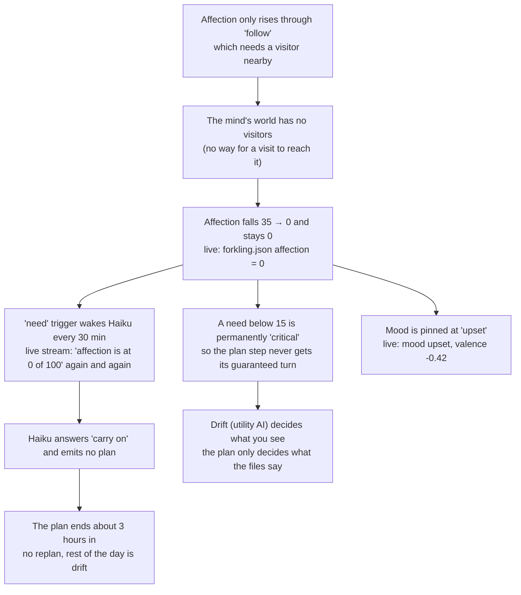

# Review, 2026-11-01: what looks wrong, misaligned or unintended

Written after Merge's first real morning on v0.7.3. Read [`how-it-works.md`](how-it-works.md) first; this file assumes it.

This is a list of findings and open questions, not a fix plan. Nothing was changed in the runtime code. Each finding has:
- **Severity:** *breaks v1* (a v1 criterion or a CLAUDE.md rule cannot hold), *degrades* (works but hurts the experience or the budget) or *minor*.
- **Evidence:** file and line, or a live commit or stream entry.
- **Intended?:** my guess at whether it was meant. Please correct me. Where I could not tell, it says "unclear".

How sure each claim is: **verified** means I opened the cited code or live file myself. **Reported** means an exploring pass read it and I did not re-open it. **Estimate** means arithmetic on the scoring code, not a measured run.

## 1. What you saw, and the chain behind it

You saw three things: not much happens, what happens repeats, and Merge is upset all the time and does little when approached. They share one root cause.

Details of each link:

1. **No way for a visit to reach the mind.** The viewer never sends anything (only read-only GitHub fetches in `apps/viewer/src/world/loadWorld.ts`). The schema (`packages/schema/src/world.ts:186-197`), the inbox reader (`apps/mind/src/world.ts:88`) and the workflow trigger (`mind.yml`) all exist, but nothing produces events. The gateway that would is listed as not-v1 in `docs/future.md`. Live `mind/state.json` has `seenEventTypes: []`. *Reported.*
2. **Affection has one source.** Only `follow` satisfies it (`species/cat/species.json:74-78`). `follow` targets a visitor. The canonical replay passes `visitor: null` (`packages/sim/src/playback.ts:182`). So in the mind's world it can never rise. *Verified.* Live: `affection: 0`, `mood: upset`, `valence: -0.42`.
3. **"Critical" blocks the plan.** `critical` is true when any need is below 15 (`packages/sim/src/forkling.ts:381`). When it is true, the "plan step wins outright" branch (`:383`) is skipped, and the plan step only competes in the random draw (`:394`). *Verified.* How often the plan then loses is an *estimate*: roughly 10 to 40 percent of choices by my reading of the scoring, which needs a measured run (see the report CLI in section 6).
4. **The `need` trigger fires forever.** A need under 15 is a trigger (`packages/sim/src/surprise.ts:72-76`), limited to once per 30 minutes (`apps/mind/src/tick/apply-step.ts:8,14`). Live stream entries 10, 15, 18 and 20 are all "affection is at 0 of 100", with thoughts like "I will not chase company; I will simply continue with my own plan". *Verified.*
5. **The model emits no plan, and nothing forces one.** When the day's plan runs out and Haiku returns no plan, `applyDecision` just deletes `goals.now` (`apply-decision.ts:99-103`). Live: the last step (`nap`) started 09:13; the thought at 10:23 says it will "start with the lamp on the desk" (step 0 of the old plan), but no plan was written and `goals.now` is gone. *Verified.*
6. **The plan was short.** Today's six steps add up to 108 minutes (3 + 10 + 5 + 10 + 20 + 60). It started at 07:03 and ended around 10:23. From then on, 12 waking hours are unplanned. *Verified from `mind/goals.json` and the commit times.*
7. **Unexplained timing.** The `shape` step says 20 minutes but ran from 07:53 to 09:13 (80 minutes), and `nap` (60 minutes) ran until about 10:23. I did not find out why. Possibly the verb's own duration overrides `minutes`, or steps only end on a tick that happens to commit. *Open: needs a look at how `until` is set.*

**Why this looks like "repeating and boring".** For the last two hours the whole visible loop has been: tick, "affection is 0", "carry on", drift (`explore`, `carry` with `targetId: "for:carry"`), repeat. On 10-31 the recent steps show `observe telescope` and `zoomies` alternating with identical reasons.

## 2. Body and mind disagree (the plan is not what the body does)

| # | Finding | Severity | Evidence | Intended? |
|---|---|---|---|---|
| 2.1 | A step's effect and skill XP land when its time runs out, wherever the body is and whatever it was doing. The journal, notebook and site then say "made X" while the viewer showed something else | breaks v1 (rule 6, "honest by construction", and criterion 5) | `apps/mind/src/tick/apply-step.ts:17-28` *verified*; how often the body was elsewhere is an estimate | Unclear. The mind has no view of what the body really did |
| 2.2 | Mind and viewer replay different walks from the same `forkling.json`: the mind anchors on the intention or `lastTickAt`, the viewer on the commit time with a mixed seed. So `intention.seed` never drives the viewer, against `apps/viewer/CLAUDE.md` | degrades | `packages/sim/src/playback.ts:71-81`, `Forkling.tsx:62`, `create.ts:61` *reported* | No (the docs say they match) |
| 2.3 | Commits that don't touch `forkling.json` (art, photos, builder merges) still move the viewer's anchor, so it re-anchors at an old position | minor | same | Unclear |
| 2.4 | The viewer loads once and never refreshes. A tab left open replays old state; a visit's effects are lost and never reported | degrades | `apps/viewer/src/Root.tsx:30` *reported* | Probably an omission |
| 2.5 | A making verb satisfies no need while curiosity falls 120 a hour (full to 15 in about 42 minutes). A long making step then trips `critical` and turns into drift. The prompt tells the model "do not plan around that" | degrades | `species/cat/species.json`, `prompts/system.ts:112` *reported* | No |
| 2.6 | At night `eat`, `play` and `carry` have no time-of-day requirement and may beat `sleep` in the draw, so the cat could get up while the bubble shows "zzz". My arithmetic only | degrades (estimate) | `utility.ts:83-92` *reported* | No |
| 2.7 | Every making/mind step takes real time but drift can take over mid-step. Replacing a plan mid-step throws away that step's unfinished effect and XP | minor | `tick/plan.ts:58` *reported* | Unclear |
| 2.8 | The thought bubble can show the plan step next to a drift reason | minor | `thoughts.ts:17-24` *reported* | No |
| 2.9 | A resumed `firstAction` skips the time-of-day check, so `sleep` can continue after waking | minor | `forkling.ts:361-368` *reported* | No |

## 3. Stagnation: ways the day ends up unplanned

| # | Finding | Severity | Evidence | Intended? |
|---|---|---|---|---|
| 3.1 | A morning plan rejected twice still marks the day as planned (`lastPlanDate` is set before the check). No `goals.now` exists afterwards, so no `stepDone` or `blocked` can fire. The whole day is drift | breaks v1 | `apply-decision.ts:79` then `:83-97` *verified* | No |
| 3.2 | A rejected replacement plan deletes `goals.now` even when today's earlier plan was fine, orphaning the remaining steps | degrades | `apply-decision.ts:96` *verified* | Probably not; the comment only mentions stale plans from another day |
| 3.3 | Plans are short (minutes add up to hours, not a day) and the code has no "plan is exhausted, make a new one" path; it relies on the model choosing to write one | degrades | section 1 above; `apply-decision.ts:99-103` *verified* | Unclear. Goal 2 in `MILESTONES.md` says "plan for today" |
| 3.4 | With no decision (budget cap, no key, call failure, a bedtime or weekly tick) the plan never advances: `knownObjects` is only updated inside `applyDecision`, so `novelty` keeps firing; with two triggers `route` never takes the free "next step" path. At the cap the plan freezes for the month, against `docs/decisions.md` ("carries on with utility AI") | degrades | `apply-decision.ts:17,80`, `tick/route.ts:11` *reported* | No |
| 3.5 | `blocked` has no cooldown. If the model answers "carry on", the same Haiku call repeats every tick until the step runs out (up to 240 minutes). Sunbeam spots depend on the sun but plans are only checked at the start | degrades | `surprise.ts`, `tick/plan.ts:29` *reported* | No |
| 3.6 | A planning order bug: `applyDecision` sets `openBuild` before re-checking the plan, and the check refuses code steps while a build is open. So a plan that passed in `think` can be rejected when it also asked for a design and contains a code step | degrades | `apply-decision.ts:52` vs `:84`, `tick/plan.ts:39` *reported* | No |
| 3.7 | `weekly` outranks `novelty`, `blocked` and `need`, and its prompt forces `plan = null`, yet `knownObjects` is updated anyway. A newly built object is marked "seen" without a reaction. Also `newDay` outranks `bedtime`, so a day of failed morning calls could skip the reflection | minor | `tick/plan.ts:13-17` *reported* | Unclear |
| 3.8 | Waking can be an hour late: while asleep only the `:03` tick runs, so a 07:00 wake becomes a plan at about 07:03 to 08:00. Live: woke at 07:03 (Sunday lie-in) | minor | `mind.yml:53` *reported* | Probably acceptable |

## 4. Loops and honesty checks that don't check enough

| # | Finding | Severity | Evidence | Intended? |
|---|---|---|---|---|
| 4.1 | An obsession can sustain itself: the obsession is the default topic for reading and art, reading is the only thing that raises a topic's weight (+0.4 each, up to 4 reads a day), and the obsession fades only ×0.8 a day. It may never burn out, against "every few days" | breaks v1 (criterion 4) | `tick/reading.ts:61`, `tick/art.ts:36`, `interests.ts` *reported*; no run yet | No |
| 4.2 | Topics are free text, so "octopus" and "octopuses" are two topics. A "new" obsession can be the old one under another name | degrades | `interests.ts:33` *reported* | Unclear |
| 4.3 | Past obsessions are never shown to the mind (only to the site), so it can relapse without knowing | degrades | `render.ts:304` *reported* | Unclear |
| 4.4 | Beliefs can be strengthened with no new evidence, and the mind's own `thought` stream entries count as evidence. That makes a loop: belief → `because` → step logged → strengthened. Journal claim checks only prove a reference id exists, not that the paragraph is true | breaks v1 (rule 6) | `packages/sim/src/claims.ts:12-13,36`, `apply-decision.ts:72` *reported* | No; the comment says strengthening needs evidence |
| 4.5 | Fixation only catches runs in a row. A-B-A-B-A-B passes, and the same plan every day passes | degrades | `validate.ts:87` *reported* | Unclear |
| 4.6 | Haiku can postpone the weekly review forever: `reviewedAt` resets whenever a decision returns any `longGoal`, even the same text | degrades | `apply-decision.ts:31` *verified* | No |
| 4.7 | The weekly Sonnet review is told to judge "what actually happened this week" but sees the last 8 steps and 3 rejections plus the summary | degrades | `prompts/weekly.ts:5`, `prompts/user.ts:137` *reported* | No |
| 4.8 | The morning prompt asks for `stayUpLate` but `applyDecision` drops it before 18:00; `lateNightReason` is written and never read | minor | `apply-decision.ts:11,61-65` *verified* | No |

## 5. Features that don't connect, and dead parts

**Written but never read by a prompt:** reading notes (only the title reaches the stream), `notebook/plans`, the timeline, past obsessions, art older than the last five titles, `lateNightReason`. So Merge cannot deliberately continue its own earlier work. *Reported.*

**Defined but doing nothing:**
- `give` can never run: plans may not use visitor verbs (`validate.ts:269`) and drift excludes verbs with effects.
- `hide`'s effect does nothing (`effects.ts:187`); `ObjectState.hiddenBy` is never written; the pack weight and the `shy` quirk weight for it have no effect.
- `WorldObject.behavior` is not read. `memory/people.json` has no schema and no reader.
- Template objects: `water-bowl` has no unlocks; `bed` is never used because `sleep` has no target; `workbench` lists `tinker` but `tinker` ignores `unlocks`.
- Likes and dislikes about weather and sound can never match an appraisal tag. The events `created`, `read`, `dropped` and `closed` have no mood impact, so finishing a creative work changes no feelings. **Mood never changes which action the body picks.**
- The `hands` precondition isn't checked for drift, so `carry` can be picked with empty paws (the live intention is `carry` with `targetId: "for:carry"`, a sim-internal label written into `forkling.json` by `tick/write.ts:82-88`).
- The bowl is free and endless, so there is no reason to harvest or cook.

**Skills and quality:**
- XP equals the step's declared `minutes`. One 240-minute `read` step is level 3; mind-group level 10 comes in about 2 to 3 days. Drift never gives XP. *Reported.*
- Art, code, photo and contraption quality all read the `mind` skill (`tick/art.ts:38,51`), so practising `tinker` (making) or `cook` (growing) never improves their artifacts, against rule 8.
- `cook` counts against the 4-a-day creative cap, so a plan to cook dinner can be rejected after four drawings.
- Reading limits aren't checked at plan time, so extra read steps pass validation, give XP, then hit "reading limit reached".
- The prompt does not show remaining quotas (creative, photo, code), which invites rejections and paid retries.

## 6. Builder and workflows

| # | Finding | Severity | Evidence | Intended? |
|---|---|---|---|---|
| 6.1 | `build.yml` shares the concurrency group `mind` with the tick. GitHub keeps only one pending run per group, so a queued tick can cancel a pending build. The request then sits for 72 hours and blocks every other build. Cancelled runs already appear on Merge | breaks v1 (criteria 2, 8) | `build.yml:16-18` and `mind.yml:14-16` *verified*; the cancellation behaviour is GitHub's, *reported* | No; the comment says the group exists so two writers don't collide |
| 6.2 | One open build, including a code PR waiting for a person, blocks all new builds. If the PR merges after 72 hours its arrival is never noticed | degrades | `builds.ts:18,29`, `settle-build.ts` *reported* | Partly (one open PR at a time is in `apps/mind/CLAUDE.md`), but the 72 hour expiry conflicts with human review |
| 6.3 | The daily design and weekly code slots are used up at request time even if the build fails | degrades | `apply-decision.ts:53` *verified* | Unclear |
| 6.4 | The code builder gets no `ANTHROPIC_API_KEY`, only federation, while the README calls the API key quickest | degrades | `build.yml:350-356` *reported* | Probably an omission |
| 6.5 | The Claude Code Action's real cost is booked only afterwards; there is no token ceiling | degrades | `tick/code.ts:233`, `build.yml:377-381` *reported* | Unclear; the root rule says the cap is hard |
| 6.6 | The builder commits `mind/state.json`, `memory/stream` and `brain/budget.json` straight to `main`, outside the allowed paths in the root `CLAUDE.md`; `checkPaths` only sees PRs | breaks a CLAUDE.md rule | `build.yml:108-120,212` *reported* | Needed technically, but the rule text is wrong or the design is |
| 6.7 | `main` is not branch-protected and the builder uses `github.token` with `contents: write`, not a scoped PAT | breaks a CLAUDE.md rule | `gh api .../branches/main/protection` returns 404 *verified* | Probably not done yet |
| 6.8 | The `pull_request` and `workflow_dispatch` validate runs for one PR share a group with `cancel-in-progress: true`, so they can cancel each other; only the dispatch run can auto-merge | degrades | `validate.yml:14-16` *verified*; PR #1 had two runs a second apart *reported* | No |
| 6.9 | The only build so far was seeded by hand. The mind itself has never asked for an object or a project | degrades | live `mind/builds` *reported* | Not a bug, a signal: criterion 2 is far off |
| 6.10 | The pages workflow is not dispatched for `forkling.json` or `mind/goals.json` changes, so the live home page is hours stale | degrades | `mind.yml:161-169` *reported* | Probably an omission |
| 6.11 | Cron barely fires; the heartbeat is the real clock. A late cron tick added a duplicate decide call | minor | `mind.yml`, `heartbeat.yml` *reported* | Heartbeat was added as a workaround; docs still say cron |
| 6.12 | Prompt caching never helps: ticks are over 5 minutes apart, so each call pays the cache write surcharge (live: `cacheWrite: 4978, cacheRead: 0` on every decide call) | minor | `brain/budget.json` *reported* | No (`apps/mind/CLAUDE.md` assumes caching pays) |
| 6.13 | The template ledger hardcodes `"month": "2026-11"`; Merge's first ledger rolled back to October and wrote a bogus history row | minor | `budget.ts:62-71` *reported* | No |
| 6.14 | The viewer's gallery slices the last 30 art files by name, not by date | minor | `loadWorld.ts:152-154` *reported* | No |
| 6.15 | Pinned engine tag `v0.7.3` is 25 commits behind `main`; the hosted viewer uses `main`, the mind uses the tag. Sim code is unchanged for now | minor | workflows *reported* | Fine today, a risk once the sim changes |

## 7. Observability: what exists and what is missing

What exists is listed in `how-it-works.md` section 9. In short, a good repo history plus a stream, a timeline, a journal, a budget ledger and a few counters. The gaps, in order of how much they would have helped this week:

1. **No record of the body's real behaviour.** Nothing compares the plan with what the body did, so a permanently critical need and a plan that loses the draw were invisible. The body runs only in browsers.
2. **No record per tick.** A tick that changes nothing leaves no trace. Failures, budget refusals, LLM errors, dropped journal paragraphs and gate skips go to the Actions log only, which `gh api` cannot read and which expires. The `stepDone`, `newDay`, `bedtime` and `weekly` triggers are never stored.
3. **No health summary.** To learn "is it stuck?" you stitch together `git log`, the stream, the ledger and `goals.json` by hand. The `live-check` skill is a manual checklist with no data file behind it.
4. **No history of needs, mood or triggers.** `forkling.json` is one snapshot; history is only in git diffs.
5. **No replay or simulation report.** `runHeadless` exists in `packages/sim/src/headless.ts`, but only tests and `validate` use it. There is no command to say "run 14 days on this seed and print time per verb, how often the plan won, and how long each need was critical". Nor one to say "show the canonical body at this commit and time".
6. **The engine version that made a commit is not recorded**, so a replay may use a different sim.

### Proposal (not built)
All of it is read-only toward the outside world and adds no LLM calls.

1. **`mind/ticks/YYYY-MM-DD.jsonl`.** One line per tick, including ticks that change nothing: time, engine ref, gate result, every trigger with its score, think kind, calls (kind, model, cost, ok or error), notes, step before and after, needs, mood, plan id. Keep 14 days. This alone would have shown the 30-minute affection loop in one `gh api` call.
2. **`mind/health.json`.** A rolling summary Claude Code can read in one call: last tick and outcome, plan state (current step, overdue, steps left, last replan), counters against quotas, triggers and calls per kind today, rejections and failures today, how long each need has been under 15, mood streak, spend against pace, open build age, and a `warnings` list ("affection critical for 9 h", "no plan for 3 h", "same step 3 times today").
3. **Body replay CLI** (`pnpm --filter @forkling/mind replay --world <dir> [--from ISO --to ISO]`). Recomputes the canonical playback from the repo with `startPlayback` and prints a compact timeline of intention, verb and needs next to the plan steps. Shows how much time the body spent on the plan versus drifting.
4. **Sim report CLI** (`pnpm --filter @forkling/sim report --days N --seed S`). Wraps `runHeadless` and prints time per verb, how often the plan step won, need minima, and the share of time each need was critical. This turns every estimate in this document into a measured number, and is also what the two-seed divergence criterion needs.
5. **Upgrade the `live-check` skill** to read `health.json` and the last ticks lines and print a verdict.

What each would have caught in the last day: items 1 and 2 would have flagged the affection loop within an hour; item 3 would have shown the plan losing the draw; item 4 would replace the guesses marked *estimate* here.

## 8. Docs that no longer match the code

- `docs/architecture.md`, `apps/mind/CLAUDE.md`, root `CLAUDE.md` and `MILESTONES.md` ("gifts left at night are found in the morning") all describe visitor events reaching the mind. They cannot yet.
- `packages/sim/src/playback.ts:11` says the 30-minute epoch "matches the mind's cron"; the real clock is 10 minutes, driven by the heartbeat.
- `packages/sim/CLAUDE.md` lists five surprise triggers; there are seven (it omits bedtime and weekly).
- `docs/architecture.md` does not list `memory/timeline/` or `heartbeat.yml`.
- `MILESTONES.md` says the sky feed has meteor showers; it does not. The news and politics filter covers Mastodon only.
- `apps/mind/CLAUDE.md` says vision runs "only when something new is in view"; planned photograph steps also queue shots.
- The decay rates are written like game-feel tuning, but time is real seconds, so the needs run about 10 to 50 times faster than a person's day.
- HUD text "F3 for Merge's mind" is hardcoded to one forkling (`App.tsx:64`); the site shows "Last seen … UTC" while everything else uses the forkling's time zone.

## 9. Purpose questions: decisions only you can make

For each, what it is for, what it does now, and options. My recommendation is first.

### 9.1 Affection and visitors
*For:* make a visit matter to Merge. *Now:* a need that nothing in the mind's world can raise, so it is a permanent alarm. The affection design assumes a visit loop that does not exist.
- **A. Take affection out of the cat pack until visits can reach the mind** (recommended). It restores the plan's guaranteed turn and ends the 30-minute wake-ups at once. Mood then depends on real events.
- B. Keep it, but let solitude-friendly verbs raise it slowly (sitting by the window, grooming), so it behaves like a mild background need.
- C. Keep it, but exclude needs the mind cannot fix from `critical` and the `need` trigger. A smaller change, but it leaves a number that is always 0 in the file.
- D. Build the visit path first (the Worker gateway in `docs/future.md`), then keep affection as designed.

Also decide what "approaching Merge" should do. Today it changes the body only inside your browser and nothing reaches the mind, so a visit cannot change its mood, beliefs or journal.

### 9.2 Who is in charge: the plan or the drift?
*For:* the root rules say the mind decides what and why, the body decides how it looks. *Now:* the utility AI decides what is visible and the plan decides what the files say, and the two meet by chance (2.1).
- **A. The plan owns the visible action; drift only fills gaps** (recommended). Apply a step's effect only after the body has spent real time on that verb, and give the plan step priority unless a need is truly critical and fixable.
- B. Keep drift in charge but derive the files from what the body did (the mind records the replay), so the journal is honest.
- C. Leave it and accept that the files describe intentions rather than events.

### 9.3 Plan length and replanning
*For:* "a plan for today", visible activity at least every 2 hours. *Now:* a plan of about 2 hours that nobody replaces.
- **A. Code asks for a new plan whenever the last step ends, with no other wake-up needed** (recommended). Rule 2 still holds: code only asks, the mind writes.
- B. Require plans to cover until the evening (a minimum total minutes).
- C. Let it be: shorter bursts of planning followed by drift is an acceptable rhythm.

### 9.4 Time scale of needs
*For:* believable pacing. *Now:* real seconds; hunger and curiosity empty in under an hour, so they act like a pet game's meters, not a day's rhythm. Decide whether needs should follow a human-paced day (decay about 5 to 10 times slower) or keep the quick cadence.

### 9.5 Mood
*For:* "the mind is visible" and believable feeling. *Now:* it is computed, shown as a pose and a word, and never changes a choice. Options: let mood weight the utility draw and appear in prompts (recommended), or drop the feature to a display-only label and say so.

### 9.6 Interests, obsessions and what Merge remembers
*For:* criterion 4, interests traced to what it read. *Now:* reading notes and past obsessions don't return to the mind, and an obsession can feed itself. Recommend: show the last few reading titles and past obsessions in the morning prompt, and make an obsession cost something (a fade that reading cannot cancel for more than a few days).

### 9.7 Builder gating
*For:* one new object a day and a coded project twice a week. *Now:* a shared lock that can cancel builds and a 72-hour block. Options: a separate concurrency group for builds, with the books committed by a small follow-up job (recommended); or keep one group and have the tick re-dispatch a pending build.

### 9.8 What "something new every 2 to 4 hours" needs
Today new things come from three paths: the plan, art/reading side steps, and builds. With plans ending early and builds stuck, there is nothing to find. Decide whether a visitor-facing "pacing" rule (for example, the mind is nudged if nothing visible has happened in 2 hours) is wanted, or whether that would push the pet toward being on rails.

## 10. A suggested order for fixing things

Not a plan, just the order that looks cheapest and most useful. Each would be its own slice with a test first.

1. **Observability items 1 to 4** (section 7). They take no behaviour decisions and let you confirm each later fix from the terminal.
2. **Decide 9.1 and 9.2.** These two answers change most of the rest.
3. **Fix the stagnation bugs** that need no purpose decision: 3.1, 3.2, 3.3 (once 9.3 is answered), 3.4, 3.5, 3.6.
4. **Fix honesty gaps:** 2.1 (effects only after real work), 4.4 (evidence for strengthening), 4.6.
5. **Fix the builder's lock and cancellation:** 6.1, 6.2, 6.3, 6.8, then the CLAUDE.md rule mismatches 6.6 and 6.7.
6. **Wire back what is written and not read** (section 5), and remove the dead verbs or give them a job.
7. **Update the docs** listed in section 8 as each item lands (`/docs-sync` after).
8. **Only then** continue to M8 (the two-week run). A 14-day run on the current behaviour would measure the affection loop, not Merge.

## 11. Measured numbers (added with the observability slice)

Sections 1 to 6 marked some claims *estimate*. These runs replace them. All are `pnpm --filter @forkling/mind sim-report --days 14` on the template world, the real cat pack, no visitors, the sleep schedule, seeds 1 and 2 (the two seeds agree within 1%; seed 1 shown). The plan the body is given is the pack's default: `sit` and `explore`, 25 minutes each, back to back while awake. "Plan window" means awake with a step running. An interruption is the body starting something other than the planned verb during the window.

| | v0.7.3 pack (with affection) | affection removed (slice 1) | + hunger, curiosity, energy decay 5x slower | + energy action costs divided by 3 |
|---|---|---|---|---|
| Time on the planned verb, in the plan window | 72.9% | 75.7% | 79.0% | 89.3% |
| Interruptions a day | 281 | 219 | 179 | 95 |
| of which `nap` / `eat` a day | 170 / 46 | 164 / 38 | 157 / 8 | 75 / 8 |
| Affection under 15, awake | 100% of the time (longest 17 h) | gone | gone | gone |
| Hunger under 15, awake (minutes in 14 days) | 0 | 187 | 0 | 5.5 |
| Energy under 15, awake (share of waking time) | 19.3% | 27.6% | 26.6% | 21.5% |
| Longest unbroken energy stretch under 15 | 220 min | 219 min | 220 min | 217 min |

What this changes in the findings:
- **1.3 ("the plan loses the draw 10 to 40 percent")**: measured, the body spent 27% of the plan window on something other than the planned verb with affection in the pack (about 281 interruptions a day), and 24% without it. Removing affection helps less than the review guessed, because even the drift draw gives the planned verb double score. The interruptions were almost all `nap` and `eat`: needs running low.
- **2.5 and 9.4 (decay rates)**: slowing the time decay of hunger and curiosity about 5x works as hoped (eat interruptions 38 to 8 a day, curiosity no longer runs empty in bed). It does nothing for energy. **Energy is driven by what actions cost, not by time** (`explore` -6, `pounce` -10, `zoomies` -5 each): the 5x slower decay left energy critical for the same 3,500 minutes. Dividing the costs by 3 helps the plan (89.3%) but not the long stretches.
- **The long energy stretches are structural.** Awake, energy rises only by `nap`, and `nap` needs a sunbeam, which exists only by day. Between the last sunbeam and bedtime nothing raises energy, so a stretch of about 3.5 hours under 15 is the same at any decay rate. This links to finding 5: the `bed` object is never used. Giving `nap` a second place to happen (a soft object such as the bed) is the fix, and is in slice 5.
- **2.6 (night verbs)**: measured, 6.8 of 116.5 bed hours (5.8%, about 29 minutes a night) are spent on something other than sleeping: `play` 4.9 h and `eat` 1.8 h over 14 days. Small, real, and fixed in slice 3.
- **Needs also decay while asleep** (`forkling.ts:194`): curiosity is under 15 for about 760 minutes of bed hours over 14 days at the current rates, and hunger only because it eats at night. At 5x slower decay this disappears.

### Finding 1.7, the 80-minute `shape` step: no tick ran
The `until` of a step is set correctly from the plan's `minutes`. The cause is on the Actions side. The `mind.yml` runs for 2026-11-01 are at 07:33, 07:43, 07:53 and then **09:03**: no tick ran for 70 minutes, so nothing could end the step that was due at 08:13. The heartbeat run that dispatches the ticks (started 03:23) finished its loop at 08:23 and dispatched its successor in the same second, but the successor only started at 09:23: the old job's completion was recorded an hour late (`completed_at` 09:23), and the new run waits for it in the `heartbeat` concurrency group. The dispatches at 08:03 and 08:13 also did not happen while the loop was running, and the retained data does not say why (the step logs could not be read). So: not a logic bug in the plan, but a stopped clock. What the observability slice adds: `mind/ticks/` shows the missing ticks, `mind/health.json` warns about "longest wait between ticks", and the `live-check` skill says to look at the heartbeat runs.

## 12. What became of each finding

Status as of the review fixes ([`plans/review-fixes.md`](plans/review-fixes.md)). PR numbers are in the `RomanKuroptev/forkling` repo: **#19** stop the loop, **#20** observability, **#21** the plan owns the body and honesty, **#22** the builder, **#23** memory and feelings, and this docs PR.

**Fixed**
- 1.1 to 1.6, the affection chain: #19. Affection removed (9.1), `replan` trigger, `need` only for needs the body cannot fix.
- 2.1 a step lands after the body did it, 2.7 a plan replacing a step: #21. 2.2 and 2.3 the viewer's anchor: #20. 2.5 long steps no longer lose to drift: #21 and #23. 2.6 night verbs: #21. 2.9 resumed action: #21.
- 3.1 to 3.7: #19.
- 4.1, 4.2, 4.3 obsessions: #23. 4.4 beliefs need evidence, 4.6 weekly review: #21. 4.8 `stayUpLate`: #23.
- Section 5: what is written is read again (reading notes, plans, art, past obsessions, limits left): #23. `give` removed, `hide` chosen by drift, the bed has a verb (`curl_up`), the paws and the `for:` label, mood weights choices, `created` and `read` move mood, XP is the minutes really spent (#21), artifact quality uses the right group, the reading limit is checked at plan time: #23 and #21.
- 6.1, 6.2, 6.3, 6.8, 6.10, 6.13: #22. 6.6 rule text: #22.
- Section 7, items 1 to 6: #20.
- Section 8, every item: this PR (`docs-sync` was run after).

**Needs you**
- 6.7 branch protection and a scoped token: steps in the #22 description. I could not confirm that the Actions identity can bypass a "require a pull request" rule.
- 9.4 the time scale of needs and the bowl: approved and built in #25 (rates, a quarter of the decay in bed, a bowl of 3 portions filled on waking).

**Deferred** (real, not needed before M8)
- 1.7 the heartbeat handover can wait an hour in its concurrency group. The tick log and `health.json` now show it within 30 minutes; the workflow itself is unchanged.
- 2.4 the viewer never refreshes. 2.8 the thought bubble can show a plan reason beside a drift one.
- 4.5 alternating A-B-A-B passes the fixation check. 4.7 the weekly review sees 8 steps (better now that it also sees the recent past).
- 5: `lateNightReason` is still never read; `WorldObject.behavior` and `memory/people.json` are unused; `water-bowl` unlocks nothing and `tinker` ignores `unlocks`; likes about weather and sound never match; `dropped` and `closed` events have no mood impact; the bowl is free and endless (fixed in #25: 3 portions a day).
- 6.4 an API key for the code builder, 6.5 a token ceiling for the code action, 6.11 the docs now say the heartbeat is the clock but the cron still exists, 6.12 prompt caching never pays between ticks, 6.14 the gallery slices by name, 6.15 the pinned engine tag is behind `main` (bump it at release).

**Won't fix**
- 3.8 waking up to an hour late: acceptable.
- `cook` counting against the creative cap: the cap is the cost of the art call, and cooking makes one.
- 6.9 the only build was seeded by hand: a signal, not a bug.
- 9.8 a "nothing happened in 2 hours" nudge: not wanted, it would put the pet on rails.

### Addendum: needs were decaying about ten times too slowly in the live system
The sim report runs the body continuously, so it did not show this: in the real replay, when the last write was older than the current half-hour epoch, playback restarted at the epoch start with the old needs and position, dropping everything between the last write and the epoch edge. Writes land a few minutes into each epoch, so only about a tenth of the decay counted (hunger fell about 2.4 an hour in a day test instead of 24). It was found while building the bowl (#25) and fixed there by carrying the body across the gap (`carryForward` in `packages/sim/src/playback.ts`). The rates approved for 9.4 only take effect with that fix. It also means the energy and hunger numbers the earlier day tests showed were the slowed ones.
