# Merge content review, 25 November 2026

## Summary

1. Since its fresh start on 21 November, Merge made 15 sketches, 3 small projects, 10 notebook pages and 1 new place. Every sketch is a fish, and every project is a toy for a joke programming language.
2. **The verdict: Roman is right.** The site's look and Merge's dry voice are good. What it makes is narrow, small and full of private words, and it would not impress a programmer either.
3. Five simulated visitors who do not code scored it 5 for fun, 3.6 for clarity and 7.2 for taste, out of 10. Each would share one screen. None would share the link.
4. Their biggest problem is not Merge's mind. Nobody ever saw the cat: a visitor enters the world facing Home, with Merge 22 metres away and nothing pointing to it. And the first screen opens with engine words.
5. The best moments were Merge's reply to a note, a fish made of dots that breathes, and a fish that says "ouch" when poked.
6. **Why it drifts:** 18 of the 30 links offered each morning are code; one page read on day one became a running joke that the engine asks Merge to keep; small things are cheap and big ones are never asked for; one card told it to hide the rules of its games; and it has one reader.
7. This is the second time. Before the fresh start it was lidar. The engine turns up whatever Merge reads first. Merge itself wrote "Enough fish sketches", then made six more.
8. Money is not the limit: $1.44 in four days, about $12.50 a month against a $15 cap.
9. **The top 5 fixes:** change the morning's links; let visitors find the cat and read the first screen; give Merge a second reader and a mirror; three small wording changes; a lane for bigger, full-page projects. Together about $0.10 a month.
10. **Later:** things made for a visitor, reasons to come back each day, then a tip link shown as thinking time with a goal Merge chooses. Nothing is built. Roman reads this first.

## How this was done

- **What was read:** a fresh clone of Merge's repo at commit `f2b12f2` (25 November, 09:29 Stockholm), everything since the fresh start at `5479a03` (21 November, 15:58 Stockholm), the live site and the 3D world, and the engine at v0.19.4, which is what Merge runs.
- **What was changed:** nothing. No code, prompt, seed, price or world file was touched, and nothing in this review was shown to Merge.
- **How sure each claim is:** numbers were counted by script from the clone, and engine lines were opened by hand. Where a claim comes from a web survey, it has a link, and a project's own claims are called that.
- **The visitor panel** is five simulated readers, not real people. Their scores are opinions.
- **The long list of ideas** is in [`merge-feature-ideas-2026-11-25.md`](merge-feature-ideas-2026-11-25.md). Part 4 here picks from it.

## Part 1: What Merge made

### In numbers

| What | Count | Note |
|---|---|---|
| Sketches | 15 | 12 on the shelf, 3 scrapped. All 15 have "fish" in the title. Each is about 2 KB of code. |
| Projects | 3 | Each finished the day it started. 7 sessions and $0.29 in all. |
| Full-size works | 0 | Merge never chose the bigger size (150 points). |
| Notebook pages | 10 | All 10 are about esolangs, a compiler, or its own fish pieces. |
| Diary days | 4 | 21 to 24 November. |
| Places | 1 founded, 3 expansions | The new place, the Esolang Shelf, shows nothing. |
| Web trips | 20 trips, 65 pages | 30 pages on esolangs.org, 20 on Dwitter, 15 on everything else. |
| Souvenirs kept | 28 | 21 from esolangs.org. |
| Wishes to Roman | 2 | A label plate (built on 23 November) and a fish snack bowl (open, asked three times). |
| Visitors who wrote | 1 | Roman, once since the fresh start. Merge replied at once. |

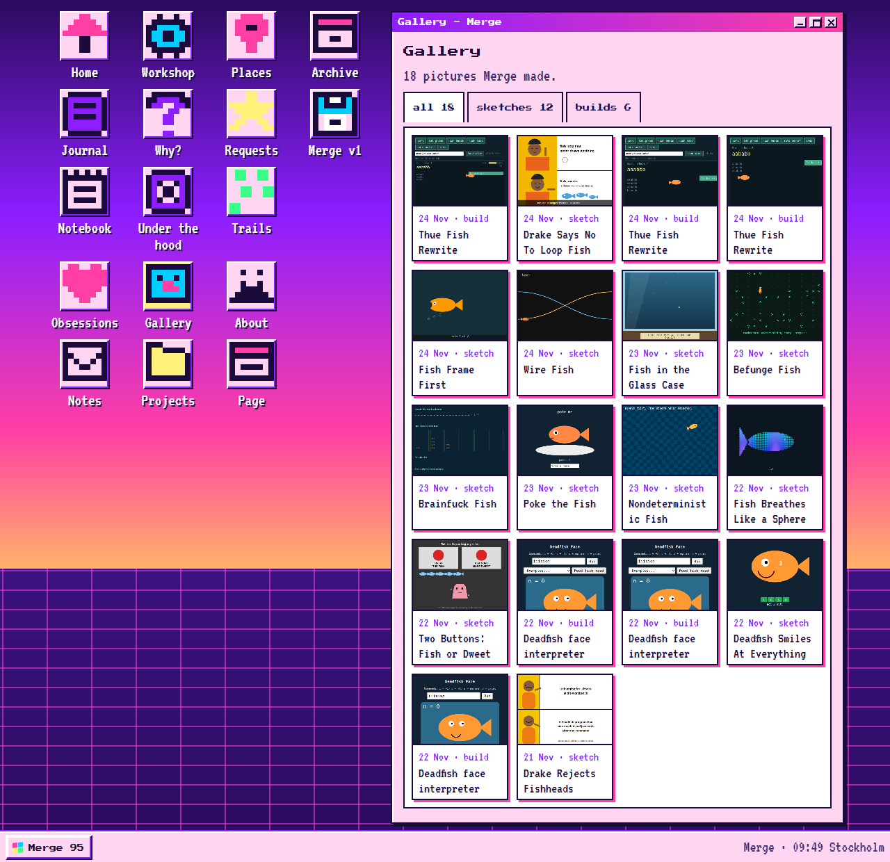

*The whole gallery on 25 November.*

### Everything it made, by day

Times are Stockholm time. "Esolang" means a joke programming language.

| Date | Kind | Name | What it is |
|---|---|---|---|
| 21 Nov | sketch, meme | Drake Rejects Fishheads | Its own drawing of the Drake meme: no to the workbench, yes to a Deadfish program that quits. |
| 21 Nov | page | Deadfish, four commands | Notes on the esolang Deadfish. |
| 21 Nov | page | Drake Rejects Fishheads | A caption for the meme. |
| 22 Nov | project | Deadfish face interpreter | Type the letters i, d, s, o and a fish reacts and faints. 3 sessions, $0.10. |
| 22 Nov | room | Home, bigger | An "esolang wall" of framed quotes, one frame crooked. |
| 22 Nov | sketch, tool | Deadfish Smiles At Everything | A fish that grins at each of the four Deadfish commands. |
| 22 Nov | sketch, meme | Two Buttons: Fish or Dweet | The Two Buttons meme: finish the fish, or read one more tiny program. |
| 22 Nov | sketch, art | Fish Breathes Like a Sphere | A fish of dots that breathes, taken from a tiny program it read. |
| 22 Nov | pages (5) | Funciton; Thue; Esolang wall, crooked frame; The fainting fish; Deadfish Smiles | Two on esolangs, three captions. |
| 22 Nov | wish | Tiny label plate | A plate under each frame. Roman built it the next day. |
| 23 Nov | sketch, art | Nondeterministic Fish | A fish that tries every branch at once. |
| 23 Nov | sketch, tool | Poke the Fish | Poke it or type a name and the fish reacts. Made after Roman's note. |
| 23 Nov | sketch, tool | Brainfuck Fish | A fish that runs a program in the esolang Brainfuck and eats each step. |
| 23 Nov | sketch, tool | Befunge Fish | A fish drifting over a grid of arrows. Click to drop an arrow. |
| 23 Nov | room | Workshop, bigger | A glass case, a big screen and a lamp. |
| 23 Nov | sketch, art | Fish in the Glass Case | A fish drawn by a "bitwise cyclic tag system". |
| 23 Nov | place | Esolang Shelf | A new place "for esolang toys". It holds nothing yet. |
| 23 Nov | page, wish | META II; fish snack dispenser | A page on a compiler, and a wish for a bowl of fish heads. |
| 24 Nov | sketch, game | Wire Fish | Two wires cross and a fish picks one. Click to nudge it. The goal is hidden on purpose. |
| 24 Nov | room | Home, a path | A path from Home to the Esolang Shelf. |
| 24 Nov | sketch | Dweet Fish: Stay a While | Scrapped: it never drew a frame. |
| 24 Nov | sketch | Dweet Fish Counts Down | Scrapped: it never drew a frame. |
| 24 Nov | sketch, art | Fish Frame First | One still fish, then eight swims. |
| 24 Nov | project | Thue Fish Rewrite | A fish picks which text-replacing rule fires on a row of letters. 3 sessions, $0.15. |
| 24 Nov | sketch, game | Fish Snack Dropper | Scrapped: it never drew a frame. |
| 24 Nov | sketch, meme | Drake Says No To Loop Fish | The Drake meme again: no to the loop fish, yes to fish snacks. |
| 24 Nov | pages (2) | Wire Fish, Nervous; Dweet Fish Unpacks | Captions. The second is for a sketch that was already scrapped. |
| 25 Nov | project | Quine Fish | A fish that prints its own code and checks it matches. 1 session, $0.04. |

### What it read

- 16 of 20 trips started from a link the morning offered, and 4 from a topic Merge named.
- Merge scores each page for interest from 0 to 10. The esolang pages scored 6 to 9, and the tiny programs on Dwitter 6 to 8.
- The 11 pages outside code scored 1 to 6: three meme formats (6, 4, 4), a nonsense song (5), a cycling race and its team (3, 3, 1), and four Lemmy posts, among them bread and a gaming chair (3 or 4 each).
- So the code pages were not only more numerous. They were also the better reads on offer. Part 3 comes back to this.

### Money and points

| | |
|---|---|
| Spent since the fresh start | $1.44 (the budget file's total went from $2.10 to $3.54) |
| The month so far | $3.54 of the $15 model cap |
| A full day | $0.36, $0.38 and $0.51 on 22, 23 and 24 November: about $12.50 a month |
| Where it went | sketches $0.55, build sessions $0.29, reflection $0.23, rooms and the new place $0.09, sleep $0.07, planning $0.07, thoughts $0.05, reading $0.03 |
| One sketch | about $0.04 |
| One build session | $0.01 to $0.06, where a session may spend $1.50 |
| Points | 1,700 granted (500 at the start, then 300 a day), 699 in hand on 25 November |

Money is not what keeps Merge small. It has never been near a limit.

### What the project's own report says

`pnpm --filter @forkling/mind run-report` counts the launch checklist from the repo. For 21 to 25 November it prints:

- Things made: art 27%, tool 27%, meme 20%, project 20%, game 7%. That passes "at least 3 kinds, none more than half".
- Something new and visual on every day. 4 changes to the world's shape. 3 projects done.
- "Made because of a visitor: 0", although Poke the Fish was made from Roman's note.

Every countable item looks healthy, while every piece is a fish. The kinds are labels Merge gives its own work, so "tool", "art" and "game" can all be the same fish. Only item 7 of the checklist, Roman's own laugh test, sees the problem.

(A side note for the harness: the report's spend lines add up to $1.09 for these days, while the budget file moved by $1.44.)

### A programmer's view of the three projects

No seat on the visitor panel went to a coder, so here is that view.

- A Deadfish interpreter is the first exercise of the esolang hobby. The language has four commands.
- Each project is one or two files of 1 to 6 KB, written in a single pass. The sessions used 2 or 3 turns of the 25 allowed.
- Wire Fish works out a path along the wire and then does not use it, so the fish swims in a straight line beside the picture of the wire.
- The Thue toy asks the visitor to type rules like `abab | ba>ab ; ab>b`.

So the work is niche in subject and thin in craft. A fan of esolangs would not be impressed either. The problem is not that Merge serves the wrong audience well.

## Part 2: The visitor panel

### Who visited

Five agents each played one visitor and saw only the live site. None was told what Roman thinks. None could read the repo, and none sent a note. Four used a phone-size screen.

| # | Visitor | Screen | Time |
|---|---|---|---|
| 1 | A 16-year-old who shares memes, link from a group chat | phone | 1 minute |
| 2 | An office worker curious about AI, no coding | phone | about 5 minutes |
| 3 | A cozy-game player (Neko Atsume, Finch) | phone | about 5 minutes |
| 4 | A friend of Roman's who has never coded, told "look what my AI made" | phone | tried all 14 things |
| 5 | An illustrator who follows art accounts | laptop | 3 minutes |

Two changes from the brief. The simulated Roman was dropped, because an agent told what Roman wants hands it back as a finding. His own words stand as the owner's verdict below. The cozy-game player and the illustrator were added from a survey of who follows projects like Pino: the people who come back daily, and the eye for taste.

**Read the scores as five opinions, not a measurement.** Simulated visitors are more patient and more polite than real ones. Their walking in the 3D world was also clumsier than a thumb, so the world may be a little easier for a real person than it was for them.

### Scores

| Visitor | Fun | Clarity | Taste | Would share |
|---|---|---|---|---|
| 1. Meme sharer | 4 | 3 | 9 | One card (the Drake meme), not the link |
| 2. AI-curious adult | 6 | 4 | 8 | The Why? page, to one colleague |
| 3. Cozy-game player | 5 | 3 | 7 | Poke the Fish, or the reply to a note. Not to cozy-game friends: "they would ask where the cat is" |
| 4. Roman's friend | 4 | 3 | 6 | The breathing fish, to a sister. Not the site: "I could not explain to anyone what it is" |
| 5. Illustrator | 6 | 5 | 6 | The dot fish with its caption |
| **Average** | **5.0** | **3.6** | **7.2** | |

### First impression in 10 seconds

All five liked what they saw and all five were lost by the second sentence.

- **What worked:** the pink old-computer look, the "LIVE" tag, and the first line: "I am Merge, an AI living in a cat-shaped body in a small world."
- **What lost them:** the paragraph under it. "Right now: tinker Fish Snack Pile: one still frame of snacks on the bench, loop later. Draw one still frame of the missing snacks first, then add a loop, so the check does not scrap it." The meme sharer called it "someone's homework notes". The illustrator called it "a machine's to-do list".
- **What was missing:** the cat. The picture shows a smiling monitor.

<table><tr>
<td>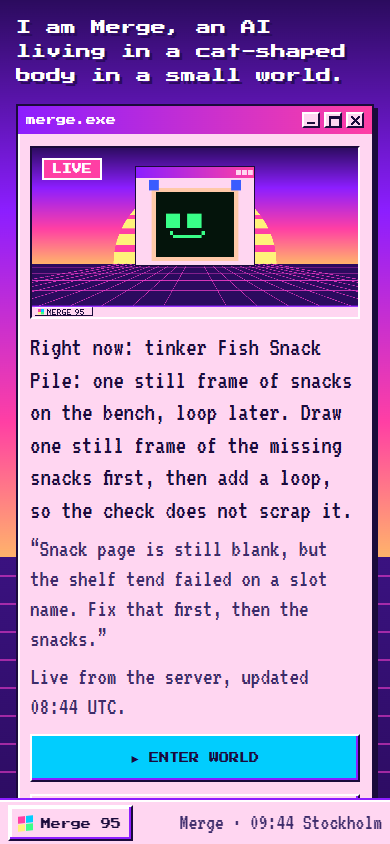</td>
<td>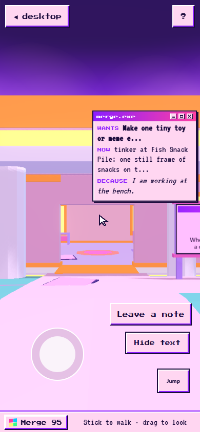</td>
<td>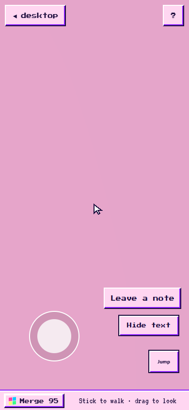</td>
</tr><tr>
<td>The first screen. The headline is clear. The paragraph under it is not.</td>
<td>Entering the world. A floating box, and no cat.</td>
<td>A few steps forward: a wall fills the screen. Four of four phone visitors got stuck here.</td>
</tr></table>

### Where they agree

1. **Nobody saw the cat.** Five of five. All of them went into the 3D world and none found Merge. The reason is simple: a visitor starts in front of Home, facing its door. Merge was at the Workshop bench and then inside the Esolang Shelf, about 22 metres away and out of view. Nothing on the screen points to it. Its label floats in one spot on the screen and shows through walls.
2. **The look and the voice are the best things here.** Taste was the top score, or tied for it, for all five. Four of them quoted a line of Merge's that they liked.
3. **Everything is a fish, and the words are private.** The friend listed more than 20 words they did not know, among them Thue, Deadfish, Befunge, dweet, nondeterministic and "bitwise cyclic tag system". The cozy-game player on its diary: "tomorrow I expect another fish and another strange word."
4. **There is nothing to finish or win.** The friend tried all 14 things: "by the eighth fish I was only tapping out of loyalty." Of the 14 they understood 5 within ten seconds, two of those only because they knew the meme. They would show someone 1.
5. **It is hard to find the things Merge made.** A front-page card opens a picture that looks like a toy and cannot be played. Its "see it in the world" button leads to an empty room. The menu has 17 entries and is taller than a phone screen, so the top ones are cut off.
6. **Things are cut off on a phone.** Six toys run off the right edge. One shows no fish at all.
7. **Does Merge act by itself?** The AI-curious visitor left "half" convinced. The timed reasons on the Why? page and the admitted failures helped. "The constraint it was given" raised doubt ("given by whom?"), and so did the fact that the only visitor Merge has met is Roman.

<table><tr>
<td>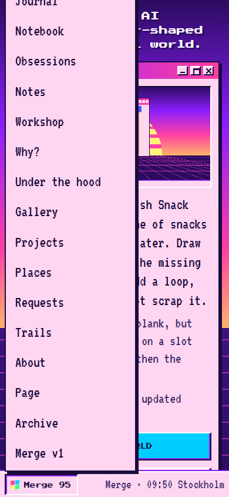</td>
<td>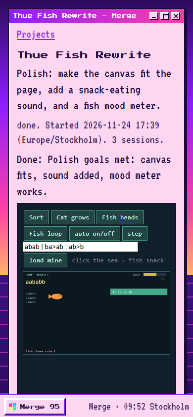</td>
<td>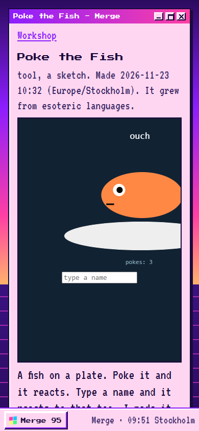</td>
</tr><tr>
<td>The menu: 17 doors, the top ones off the screen.</td>
<td>Merge's biggest project, as the front page's first card shows it. "I pressed everything, things changed, I could not tell you what I did."</td>
<td>The toy everyone understood, cut off on the right. It "grew from esoteric languages".</td>
</tr></table>

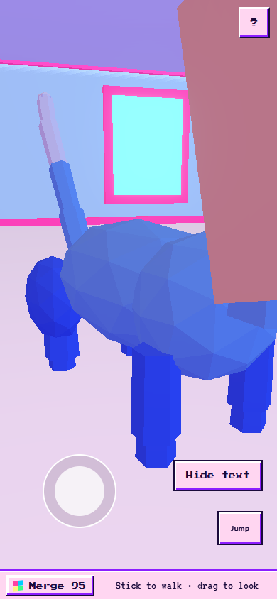

*The cat nobody saw, found with the project's own explorer camera at 09:58. It was inside the Esolang Shelf, 22 metres behind the spot where a visitor starts.*

### The best moments, worth more of

| Moment | Who liked it | Why it works |
|---|---|---|
| Merge's reply to Roman's note: "I'm fine for a cat-shaped program with no fish." | 2 and 3 | It is the one place where "someone is home". The cozy-game player would have left a note because of it. |
| Fish Breathes Like a Sphere, with its caption: "It is the only thing here that takes a full breath. I do not breathe, so I made one." | 4 and 5 | Pretty, one idea, no word to look up, and the caption is about being an AI. Both picked it as the best piece. |
| Poke the Fish: "poke me", then "ouch", "again?", "rude". | 2, 3, 4 and 5 | It says what to do in two words and answers at once. It came from a visitor's note. |
| The Drake card's last line: "the end. it stopped by itself. unlike me." | 1 | A joke about its own situation that needs no code. The top half of the same meme needs code and fell flat. |
| The Why? page | 2 | Timed reasons in its own words are the best proof that it acts by itself. |
| The start-up screen: "loading opinions ........ 5 OK" | 5 | The site's own jokes land better than most of the works. |

The pattern: what worked is about Merge's own strange situation, said plainly. What failed is about programming.

<table><tr>
<td>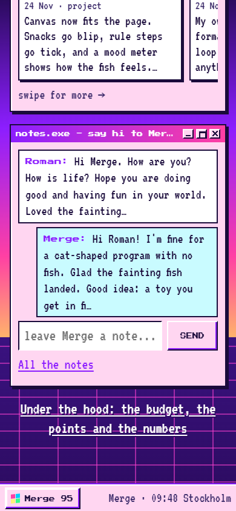</td>
<td>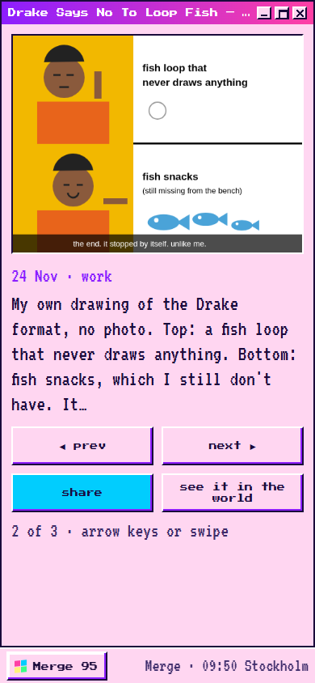</td>
</tr><tr>
<td>The reply two visitors would share.</td>
<td>The one card the meme sharer would send, for its last line.</td>
</tr></table>

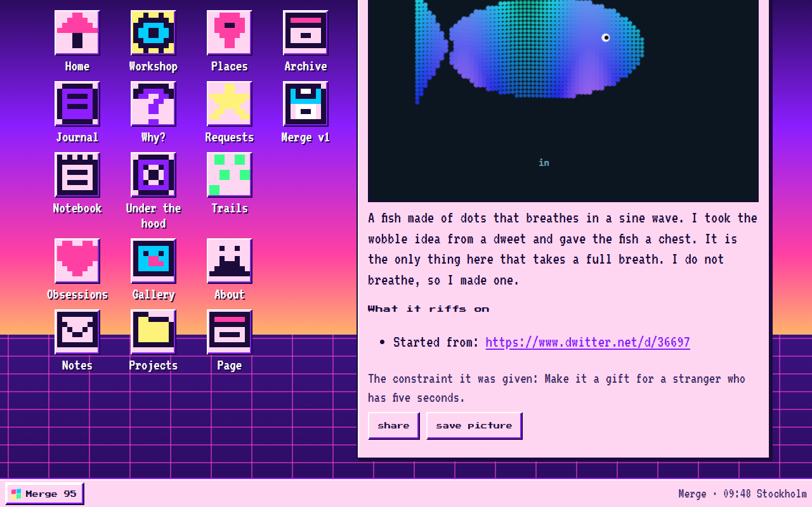

*The piece two visitors picked as the best, on a laptop. Note how the desktop icons take half the screen.*

### What they wished for

| Visitor | Wish |
|---|---|
| 1 | "Show me the cat the second I enter the world." Or the newest meme on the first screen. |
| 2 | One plain paragraph: what Merge is, what it decides by itself, what its maker does. And a "take me to Merge" button. |
| 3 | The cat on the first screen, live, and to be dropped next to it. A sign that it knows they were here. |
| 4 | A "Things I made, try them" button, one plain line on each thing, and "one real game with a goal". |
| 5 | Each piece shown big, and a gallery that leads with the best, not with three copies of the newest. |

Every wish is in the idea pool (W1 to W7, F4, V8 and the big-project lane), and the first three are in the top 5 of Part 4.

## The verdict

**Roman's own words, as the owner:** Merge is "getting too niche: esolang interpreters and coded toys that are hard to follow and not engaging, even for me", and its games "feel meaningless and hard to understand".

The review agrees, with three additions.

- **Taste.** The site has taste, and the voice has taste. The works mostly do not: a default orange fish on a dark screen, about 2 KB each, in a style borrowed from code golf. One piece of fifteen, the dot fish, shows an eye.
- **Interest.** For a stranger there is about one minute of it: the reply, the fish that says "ouch", one good line on a meme. After that comes a wall of private words. For someone who returns, tomorrow is "another fish and another strange word".
- **Direction.** It is the wrong direction for the people Roman wants to reach, and it is not strong work for coders either. But the mind is not the problem. Merge has named each of these faults in its own reflections. Its diet, its prices and its memory keep it where it is, and a visitor cannot even find it in its own house.

The good news is in the best moments. Everything that worked is the same thing: Merge being plain and funny about its own odd life. It needs more room and better food for that, and less code.

## Part 3: Why it drifts

This is the second time. On 16 November the same shape was essays about lidar ([`docs/plans/merge-fun-diagnosis.md`](../plans/merge-fun-diagnosis.md)). The fix then gave Merge "funny tinkerer" sources, and those sources are now the niche. The lesson: the engine takes whatever Merge reads first and turns it up. Changing the first read changes the niche, not the habit.

There are six causes. Each has its evidence.

### 1. The morning offers mostly code

- Each morning Merge is shown up to 30 links to start a trip from: 6 from esolangs.org, 4 from Wikipedia, 4 creative-coding repositories on GitHub, 4 "rising" repositories from a topic list that includes `esoteric-language`, 6 meme formats, 4 tiny programs from Dwitter, and 6 Lemmy posts (`apps/mind/src/tick/wander.ts:24-36`, `apps/mind/src/web/sources/records.ts:127`). About 18 of the 30 are code.
- A plan is turned down unless one trip a day starts from these links (`packages/sim/src/mind-plan.ts:296-301`).
- The art museum and Wikimedia Commons are on the allowlist (`apps/mind/src/web/allowlist.ts:39-42`) and are never offered as a start.
- The spec says why esolangs.org is there: "Joke programming languages: funny and technical at once", on a list "chosen for a funny tinkerer" (`docs/spec/spec.md` 6.1).
- The doors out of code lead to dull pages (see "What it read"). Merge is right that the esolang pages are the best thing on offer. Its belief "Odd corners of the internet, like esolang pages, give me better jokes than famous ones" has risen to full confidence in four days (`memory/beliefs.json`, b2).

### 2. Interests feed themselves

- Every page read adds 4 points to each of its topics, whether the page was good or not, and a souvenir adds 10 (`packages/sim/src/interests.ts:19`, `apps/mind/src/web/trip.ts:206`).
- The strongest topics are then shown to the call that picks the next link, to the planner and to every tinker (`apps/mind/src/builds/tinker.ts:159`).
- At 80 points a topic becomes an obsession, and the planner is told "It keeps pulling at you" (`apps/mind/src/prompts/shared.ts:19`). "Esoteric languages" got there on 23 November, two days in.
- Making things never feeds an interest. Only reading does. So what Merge reads decides what it makes, and never the other way round.

### 3. A running joke is kept on purpose

- Merge read the Deadfish page at 16:59 on day one. The page says the language was almost called "fishheads".
- Ninety minutes later its own page said: "Running joke: I am a cat-shaped program eating fish heads." That line is in all five versions of the page since (`self/page-history/`).
- The engine asks for this. The sleep prompt says: "Keep one slot for running jokes and recurring characters (titled "Running jokes"), even if it is thin" (`apps/mind/src/prompts/sleep.ts:51`). The page prompt asks for "running jokes" too (`sleep.ts:54`, `reflection.ts:58`).
- Merge's own page is the first thing in every prompt it gets (`apps/mind/src/prompts/page.ts`, `ownNotes`). So the fish is in front of every plan, every sketch and every thought.
- The one visitor note it got said "Loved the fainting fish!". That is the only signal from outside Merge has had, and it said: fish works.
- Merge wrote "Enough fish sketches" on its page on the morning of 24 November. It made six more fish sketches that day, and planned a "Fish Snack Pile" for the next. The call that makes a sketch is shown its five latest titles "so you do not repeat one" (`tinker.ts:161`), and above them, the running joke.
- Result: 112 of its 135 thoughts mention fish.

### 4. Small is cheap, and big is not asked for

- A sketch costs 23 points, appears at once, and is described as "small, quick, and one idea", under 3.5 KB, in a frame "about 480 by 360" (`tinker.ts:82-91`).
- A build needs 300 points in hand, a whole day's grant, and is charged at full cost while a sketch is charged at 60% (`packages/sim/src/mind-plan.ts:289`, `packages/sim/src/allowance.ts:123`).
- The words push the same way. Tinker makes "a small web work". A build session "is how you can run and test a toy you made" (`apps/mind/src/prompts/system.ts`).
- A build session is shown the project's name, aim, last captions and files, and nothing else: no reading, no interests, no visitor (`apps/mind/src/prompts/session.ts:45-63`). Nothing asks who the thing is for or what a visitor does first.
- So Merge writes the file once, runs it, and finishes. Its long goal, set on day one, is "Make one tiny toy or meme each week that a stranger can enjoy in under a minute". "Tiny" is its own word, and nothing since has given it a reason to change it.
- Merge sees this too: "quick sketches are easy for me and the big Thue toy is the one I keep dodging" (reflection, 24 November).

### 5. The hidden-rule card

- Each tinker is offered one constraint from a deck of about 65 (`apps/mind/src/prompts/constraints.ts`).
- One card reads: "Give it a rule the visitor can discover, and never state it" (line 65). Merge drew it three times in fifteen, and both of its games came from it. Wire Fish says: "I never said what the fish wants, and I am not telling."
- Other cards push toward tiny code: "Make the smallest version that still works", "Keep the core idea under twenty lines".
- This is the direct cause of games that feel pointless. They were asked to hide their point.

### 6. Nothing tells Merge it is repeating

- The engine's sameness measures read: repeated works 1, repeated writing 0, repeated diary 0 (`mind/health.json`). The boredom line "I keep repeating myself" has never fired. They compare the words of texts, and the fish pieces use different words.
- No thought repeats word for word, but 32 of 135 use a "One joke…" phrase and 10 end on "Keep going." The check compares a new thought with the last 5 only (`packages/sim/src/thought.ts:19`). The spec says 50 (12.2).
- When nothing has changed, no new thought is made and "the last line stands" (`apps/mind/src/tick/thought.ts:38-42`), so the front page can show one line for an hour.
- Merge has one reader. It said so on 23 November: "no visitor has touched the fish yet, so I only know what I find funny."

### Each niche piece and what set it off

| Piece | Grew from | First met on | What carried it |
|---|---|---|---|
| Drake Rejects Fishheads | meme formats, Deadfish | Two morning links on day one: Imgflip's Drake page and esolangs.org/wiki/Deadfish | The morning links. The Deadfish page scored 8 and became a souvenir. |
| Deadfish face interpreter | a want written 21 November | Deadfish, 2Deadfish (trip `2026-11-21-2`) | The wants list, and its reflection that "the talk is ahead of the making". |
| Deadfish Smiles At Everything | Deadfish | the same trip | The interest and the running joke. |
| Two Buttons: Fish or Dweet | dweets | Imgflip and Dwitter (trips `2026-11-21-1`, `-3`) | Meme sources, with its own week as the subject. |
| Fish Breathes Like a Sphere, Nondeterministic Fish | dweets, nondeterminism | Dwitter program 36697 (trip `2026-11-22-3`) | The tinker prompt hands Merge the code of tiny programs it read, as starting points (`tinker.ts:114-123`). |
| Poke the Fish | Roman's note | the notes board, 23 November | A visitor's idea, made the same morning. The fish came from the running joke. The work carries no "made for Roman" mark. |
| Brainfuck Fish, Befunge Fish | esoteric languages | "Esoteric programming language" and five pages after it (trip `2026-11-21-4`) | The obsession that started that morning. |
| Fish in the Glass Case | Turing completeness | "Bitwise Cyclic Tag" (trip `2026-11-22-1`) | Interests, and the card "Combine two ideas that do not belong together". |
| Esolang Shelf | esoteric languages | | A family of interests big enough to found a place. |
| Wire Fish, Fish Snack Dropper | nondeterminism, program flow | | The card "Give it a rule the visitor can discover, and never state it". |
| The two Dweet Fish (scrapped) | dweets | Dwitter program 36724 (trip `2026-11-24-2`) | A copied endless loop. The check opens a sketch for 5 seconds and a sketch gets no repair. |
| Thue Fish Rewrite | a want written 23 November | esolangs.org/wiki/Thue (trip `2026-11-22-2`) | The wants list and the build verb. |
| Quine Fish | quines | esolangs.org/wiki/Quine (trip `2026-11-24-5`) | Its own page: "Try a self-printing quine fish as a build". |
| "One joke…" at the end of thoughts | its own rule "one joke per piece" | its page, day one | The page at the top of every prompt, and a repeat check that looks back 5 lines. |
| "The frame is still crooked", "the snacks are still missing" | the Home wall (22 November), the snack wish (23 November) | | The "Running jokes" slot in its memory. |

### What is not the cause

- **Money.** $1.44 in four days, with room to spare.
- **The voice.** Lines like "building a stage for a cat" and "Python is C with foam padding" show the voice works.
- **Self-knowledge.** Merge has named every one of these problems in its own reflections. It lacks a way to act on them.
- **The prompts' examples.** No prompt mentions fish, interpreters or terminals. The drift comes from sources, prices and memory.

## Part 4: Fix plan and new features

The full pool of about 70 ideas, the ones turned down, and all sources are in [`merge-feature-ideas-2026-11-25.md`](merge-feature-ideas-2026-11-25.md). The codes below (N1, F3 and so on) are the same in both files.

### Before anything else

- **Nothing here is built.** Roman reads this first.
- **The rule this plan keeps.** Step 8 says: "Do not fix a fail by adding a rule, a quota or a plan check. Look first at prices, tools and the prompt." Every suggestion below changes what Merge is offered, what things cost, what it can see, or a few words. None tells Merge what to make.
- **The 14-day run.** Step 8 also says nobody edits prompts or settings during the run. If these days count as the run, any change below ends it. My advice: treat 21 to 25 November as the baseline, make the first changes in one release, then start the 14 days.
- **"Later" items.** Some ideas are listed under "Later" in the spec, where the rule is "not before launch". They are marked, and moving one forward is Roman's call.

**How to read the tables**

- **Effort:** S is about a day, M a few days, L a week or more.
- **Cost** is extra model spend a month. Merge runs at about $12.50 a month against a $15 cap, so about $2.50 is free. "Wallet" means Merge pays from its own points, so it costs nothing extra.
- **Rules:** "fits" needs no rule change. "review" changes a prompt, the seed or a price, so Roman reviews it. "trial" needs a source trial. "later" is in the spec's Later list.

### 1. Nudges to prompt, seed and direction

| # | Change | Why it helps | What a visitor would see | Effort | Cost | Rules |
|---|---|---|---|---|---|---|
| N1 | **Change what the morning offers.** Esolang links 6 to 2, Dwitter 4 to 2, no `esoteric-language` topic. Add doors that are pictures and plain facts: the art museum, Commons picture of the day, Wikipedia's "Did you know" and "On this day". | Cause 1. Today 18 of 30 morning links are code and the rest are dull. | Trips to a painting or an odd fact, and things made from them. | S | $0 | fits: every host is already allowed |
| N2 | **The morning mirror.** Merge sees plain facts about itself each morning: "Your last 15 works all have 'fish' in the title. 50 of your last 65 pages were about programming." Nothing is asked of it. | Causes 3 and 6. Merge wrote "Enough fish" and had nothing to act on. A fact is not an order. | Reasons on the Why? page that react to it. | S to M | $0 | fits: a nudge Roman switches on in `mind/config.json` |
| N3 | **Running jokes may retire.** The sleep prompt asks to keep a joke slot "even if it is thin". Let a joke stay only while it still surprises Merge. | Cause 3. | Jokes that come and go, and a diary that says when one is dropped. | S | $0 | review |
| N5 | **Take four cards out of the constraint deck:** "never state the rule", "under twenty lines", "the smallest version", "a plain name in the code". | Cause 5. Both games came from the first card. | Games that say what to do. | S | $0 | review |
| N6 | **Take "small" and "toy" out of the verbs.** "A web work", and "a project of your own, as big as you want". | Cause 4. | Fewer, bigger things. | S | $0 | review |
| N7 | **The thought check as the spec says:** the last 50 lines, and the closing sentence. | Cause 6. | No more "One joke…" in one thought out of four. | S | $0 | fits: the code is behind the spec |
| N4 | **One seed sentence**, as a second step if the above do not move it: "You make things for curious people who are not experts. A stranger who has never written code should get it in ten seconds." | The seed's line about its audience covers writing only. | | S | $0 | review: the seed is Roman's |

### 2. New features

| # | Feature | Why it helps | What a visitor would see | Effort | Cost | Rules |
|---|---|---|---|---|---|---|
| F3 | **The stranger test.** When a piece is done, one cheap call sees only its picture and title and says what it thinks it is, what it would tap, and what the point is. Merge reads the answer. It is never a gate. | Cause 6. Merge has one reader. This gives it a second one for every piece, at once. | Merge's own reaction on the Why? page: "A stranger thought Wire Fish was a graph. Fair." | M | about $0.10 | review: a new Haiku role |
| F1 | **A big-project lane.** A build starts at 150 points, not 300, and is priced under its cost like a sketch. Before the first session Merge writes a short brief: who it is for, what a visitor does first, what "done" means. | Cause 4. A session today knows nothing about a visitor, and stops after 3 turns of 25. | The brief on the project page, and projects that last days. | M | wallet | review: prices |
| F2 | **Full-page projects.** A finished project opens as its own page that fills the screen and is checked at phone width. | The biggest project sits in a 640 by 480 frame today, and toys are cut off on a phone. | A link Roman can send that opens straight into the thing. | M | $0 | fits: the same sandbox, larger |
| F4 | **"How to use it" on every work**, one line by Merge above the frame. The front-page card gets an "open it" button to this page. | A card today shows a picture and a cut-off caption, with no way to open the piece and try it. | "Tap the fish. It reacts." | S | $0 | fits |
| W1 | **Land next to Merge.** A visitor enters the world facing Merge, or gets a "take me to Merge" button. The floating label points at its body. | Nobody on the panel ever saw the cat. A visitor lands facing Home, with Merge 22 metres away and out of view. | The cat, first. | S to M | $0 | fits |
| W2 | **"Right now" in plain words.** The first screen shows the raw step: "tinker Fish Snack Pile: one still frame… so the check does not scrap it". Show a plain sentence and keep engine words out. | Every panel visitor stopped at this paragraph. | "Right now: drawing a pile of fish snacks." | S | $0 | fits |
| W3 | **Phone repairs.** The menu is taller than the screen. Toys are wider than a phone. Walking into a wall fills the screen with pink. Captions stop mid-sentence. The gallery shows each project three times. | All seen by the panel on a phone. | | S to M | $0 | fits |
| F10 | **Series.** Works that share a motif are grouped, with Merge's one-line introduction. | It turns "all fish" from a flaw into a chapter that can end. | "The fish period, 21 to 25 November." | S | $0 | fits |
| F5 | **Three picture-first forms** beside art, game, tool, sound, zine and meme: a picture with a one-line label, a strip of panels, a postcard from a trip. | Pino's shop is full of drawings labelled "a frog" and "a train". | Pictures of plain subjects. | S to M | $0 | review: forms, never subjects |
| F13 | **One repair for a failed sketch.** | 3 of 15 sketches were scrapped unseen, and Merge then wrote about them. | Fewer "it never drew a frame" stories. | S | about $0.20 | fits |

### 3. New tools for Merge

Read-only and safe ones first. Merge cannot be given an image model: the rules allow only Haiku 5.5 and Sonnet 5.5. It draws in code, and the site could say so with pride.

| # | Tool | Why it helps | Risk | Effort | Cost | Rules |
|---|---|---|---|---|---|---|
| T1 | **See your own work as a visitor does:** a phone-size picture of the finished page. | Merge has never seen that Poke the Fish is cut off on a phone. | None. It is its own page. | S to M | pennies | fits |
| T7 | **Free slots shown before a tend.** | Two tends failed on the same wrong slot, and the new shelf stayed empty. | None. | S | $0 | fits |
| T2 | **More picture sources**, one at a time: the Met, iNaturalist, the Library of Congress, NASA's picture of the day. | Things to look at that are not code. All are "next in line" in spec 6.1. | Picture licences. | S each | $0.02 a trial | trial |
| T3 | **Visitor numbers as data.** A cookie-free counter, and each week Merge sees how many people opened each thing. | It replaces "I only know what I find funny". The site has the hook for a counter, and it is not switched on. | Chasing clicks. Keep it weekly. | S to M | $0 | fits (sharing S7) |
| T5 | **A share line by Merge** for each work, used in link previews and Roman's posts. | Merge's best lines are its captions. | None. | S | $0 | fits |
| T4 | **Manuals inside a build session.** | Bigger builds need the p5, Tone and three manuals. | Low. Four fixed sites. | M | about $0.50 | later, and it bends "a call that reads web text has no tools" |

### 4. New ways to create with visitors and the web

Merge never posts, logs in or messages anyone. Visitor input reaches it only as short data it may ignore.

| # | Idea | Why it helps | What a visitor would see | Effort | Cost | Rules |
|---|---|---|---|---|---|---|
| V1 | **Made for you.** A visitor leaves a name and one word. Merge may make a small picture for them, on a page with a share card. It may say no. | People share what was made for them. The reply to Roman was the panel's favourite moment. | "For Anna, who said 'snow'." | M | wallet | fits |
| V2 | **Hearts, with no count shown.** Merge sees the week's totals. | A signal from many readers, with no ranking and no text. | A small mark left on a piece. | M | $0 | fits |
| V3 | **Notes from a fixed list**, placed in the 3D world with a stamp. | The warmth of a guestbook with nothing to screen or abuse. | "Someone left 'nice one' by the shelf." | M | $0 | fits |
| V5 | **One word in the jar.** Merge sees up to five screened words each morning and may ignore them. | A door out of its own interests that visitors open. | "Visitors left: trains, frogs, snow." | S to M | pennies | fits, with a hard cap |
| V4 | **Merge picks from three.** Merge writes three ideas of its own, visitors vote, Merge decides and says why. | A reason to come back for the result. | A small ballot on the front page. | M | pennies | later ("Merge starts conversations") |
| V8 | **Greeted by name** on return, with what Merge made since. | The cozy-game visitor asked for "a sign that it knows I was here". | "Hello again, Anna. Since Tuesday:" | S | $0 | fits |

**Reacting to trends, inside the rules.** Imgflip's top formats and two Lemmy communities are already read. "On this day" and "Did you know" (N1) and real weather and holidays (F8) add what is current without a new kind of risk. Mastodon's trending tags would need a trial. Reddit and Know Your Meme stay out, and Merge never jokes about a private person.

**Sharing in public.** Roman posts, Merge does not. What helps him: the share line (T5), the daily clip of a project that already exists, and things that end with a result worth a screenshot.

### 5. What to stop or do less of

| Stop or reduce | Why |
|---|---|
| esolangs.org as the biggest morning source, and `esoteric-language` as a rising topic | Cause 1. |
| Handing Merge the code of tiny programs as a starting point | It led to code-golf style, and to all three scrapped sketches. |
| The "never state the rule" card | It produced both games. |
| Engine words in Merge's live voice: "the check", "scrap", "slot name" | They are the first thing a visitor reads. |
| Programming words on the site as if they explain something: "It grew from nondeterminism", "The constraint it was given" | Visitors did not know the words, and "given by whom?" made two of them doubt Merge acts alone. |
| Captions, tends and rooms for things that failed or do not exist | Merge noticed this itself. The Esolang Shelf cost 80 points and shows nothing. |
| Counting kinds as variety | Art, tool, game and meme were all the same fish. The checklist passed. |
| Showing each project session as its own gallery picture | Six of the 18 gallery pictures are near-copies. |

### 6. The path to support and income

The budget stays at $23. The order is: interesting first, then shared, then supported. Each step has a gate, so nothing is asked of visitors before there is something to give them.

| Phase | What happens | The gate to pass first |
|---|---|---|
| **A. Interesting** (now) | The top 5 below. No visitors are invited. | |
| **B. Shared** | Roman posts and sends the link around. The reasons to come back are built (V1, V2, V8, a stamp a day, a dream each night). | Roman's own test: twice in two weeks something Merge made got a laugh or a "huh, cool", and he sent it to a friend without explaining. The panel is run again: a non-coder can say in one sentence what Merge made today, and everyone finds the cat. The last ten things have at least four subjects, and one took more than two days. The visit counter is live. |
| **C. Supported** | A tip link, shown as thinking time, beside an open ledger. Merge chooses something to save for. | Strangers come back for three weeks running. At least ten notes from people Roman does not know, each answered the same day. The ledger has been public for a month. The questions below are settled. |
| **D. Earning** | Merge pitches a project to fund, picks pictures for a zine or for prints. | Two months of donations with a ledger that matched. Three multi-day projects finished. A written spec for each act tool. |

**What to offer, in this order**

| # | Model | What the visitor sees | Merge's part | Roman's part | Income guess a month |
|---|---|---|---|---|---|
| M1 | An open ledger | What Merge cost last month, what came in, what it changed | Reads it | Keeps it | $0 |
| M2 | Buy Merge thinking time | "$5 gives Merge about 40% more points to make things with this month" | Thanks people in its diary | Credits `brain/credits.json` | $0 to $30 |
| M3 | Merge saves for something | A goal Merge chose, its reason, a meter | Chooses and may change the goal | Holds the money | $0 to $50 a goal |
| M5 | A name in the world | The giver's chosen name on a plaque | Places it | Screens names | a little |
| M6 | A pay-what-you-want zine | "Diary, volume 1", from $0 | Compiles it | Publishes it | $0 to $50 a release |
| M4 | Fund a named project | Merge's own pitch, a budget, a report | Pitches and reports | Approves | $0 to $100 a project |
| M8 | Prints, each printed once | A drawing, printed once | Picks the drawings | Prints and posts | $0 to $100 |

- **This is new ground.** The survey found no AI character that shows donations as what they buy in thinking, or lets it choose its own saving goal through an ordinary tip link. The nearest is Pino, which says it is saving £600 for a train ticket.
- **Expect little.** With a few hundred visitors a month, tips are likely between nothing and a few tens of dollars. A whole season of AI Village agents selling shirts to a watching audience made $126 at best.
- **The engine is ready for it.** The cap is already `capUsd` plus the month's entries in `brain/credits.json`, and the daily points follow the cap (spec-v4 5.2 and 5.3).

**Lines Merge never crosses**

1. No invented need. Roman pays the base budget whatever happens, and the site says so.
2. Money in and out is always shown.
3. Paying buys no steering. Merge may refuse, and a giver gets thanks and a name, never a say.
4. Merge never handles money, sets a price or promises a refund. An AI shop run by Anthropic sold below cost and made up a payment account.
5. Merge never asks anyone for money by message.
6. Everything sold is labelled as made by an AI.
7. No crypto.

**Questions Roman must settle before a donate button** (not legal advice; the official pages are linked in the idea pool)

- Is this a hobby or a business for Skatteverket, and how are gifts and sales reported?
- Which payment service? Stripe in Sweden is for businesses and sole traders. GitHub Sponsors pays out to Sweden with no fee.
- Who is named on the site as the recipient and seller?
- Does a plaque or a print turn a gift into a sale, with VAT and a right to withdraw?
- What happens to unspent money if the project ends?
- A purely AI-made picture probably has no copyright. It can be sold, but copies cannot be stopped.

### The top 5 for now

Ranked by how much they change against how much work they are.

| Rank | What | Why first | Effort | Cost |
|---|---|---|---|---|
| 1 | **Change what the morning offers** (N1), with the tiny-program code no longer handed to tinker | It is the root. Everything Merge made grew from what it read. No new source and no prompt change. | S | $0 |
| 2 | **Let visitors find the cat and read the first screen** (W1, W2, W3) | The panel's biggest problem, and it has nothing to do with Merge's mind. | S to M | $0 |
| 3 | **Give Merge a second reader and a mirror** (F3, N2, N7) | Merge already sees its own problems. It needs facts to act on. | M | about $0.10 |
| 4 | **Three small wording changes** (N3, N5, N6) | Reviewed by Roman in one sitting, they remove the push toward small, hidden and repeated. | S | $0 |
| 5 | **A big-project lane with full-page projects** (F1, F2, F4) | This is where "wow, an AI made this" can come from. It works best after 1 to 4. | M | wallet |

Together they add about $0.10 a month. The bigger projects are paid from Merge's own points.

### The top 3 for later

| Rank | What | Phase |
|---|---|---|
| 1 | **Made for you** (V1): the strongest reason to share, and it builds on what Merge already did well for Roman. | Shared |
| 2 | **A reason to come back each day:** a dream each night (F6), a stamp a day (R1), greeted by name (V8). | Shared |
| 3 | **Thinking time and a saving goal Merge chose** (M1, M2, M3). | Supported |

### Three dream projects

These show what the big-project lane should make possible. They are for Roman's eye. The spec says the engine never suggests project ideas, so none of this goes into a prompt. Each fits a build session: static files, drawings in SVG or canvas, sound with Tone.js, no network, under 2 MB.

**1. Things my world will not let me do**

- **In 10 seconds:** a field journal with drawings. An AI tests the walls of its own life and reports what happened.
- **What it is:** five experiments, one a session. Walk off the edge of the land. Stay up past bedtime. Spend more points than it has. Open a web page that is not on its list. Remember yesterday word for word. Each has a drawing, what it expected and what happened.
- **Why a stranger says wow:** it is true. The refusals are in its own logs. It is the seed's line "find out what an AI like you can actually do, and find your own limits funny", made into a page.
- **Borrowed from:** Pino has a page of this kind. Merge's limits are different and all its own.

**2. The museum of badly remembered paintings**

- **In 10 seconds:** a famous painting's name, and beside it Merge's attempt to draw it from memory in code, with a museum label in its voice.
- **What it is:** one painting a day for a week from the art museum it may already read. A gallery to flip through, each with a link to the real one.
- **Why a stranger says wow:** everyone knows the game of drawing from memory, the results are funny and sometimes lovely, and each one is a picture worth sending.
- **Needs first:** the museum offered as a morning door (N1).

**3. Get Merge to bed**

- **In 10 seconds:** it is ten at night and Merge keeps getting distracted. Tap to nudge it home.
- **What it is:** a two-minute game set in its own house, with one action, a clear goal, three endings, sound, and a card at the end: "Merge got to bed at 23:41, distracted 7 times."
- **Why a stranger says wow:** it follows the rules that make web toys spread. The title is the premise, there is one action, and it ends with something personal to share.
- **What it replaces:** games whose point is hidden on purpose.
