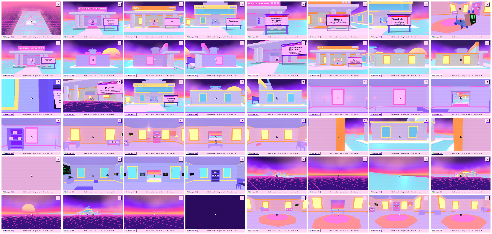

# Audit harness Phase 1: done (20 November 2026)

Phase 1 of the audit harness is built (Q0, Q1, QB, QS, QW, QT) and its first run (QR) has found and fixed what it was built to find. **One thing is not done: the release.** It waits for Roman (see "Waiting for Roman", item 1).

## What the harness checks now (one line each)

- `pnpm qa fast` (every PR, `qa.yml`): fixture worlds parse; promised sources against the allowlist; web snapshot format and allowlist; every fixture opens in the real viewer and its scene lists every place, room, work and Merge; geometry (nothing floats, sinks, overlaps or pokes through a wall; parts not in mid-air; exhibits on their part; doorways clear); work screens show a work and hang at eye height; exhibits and gallery tiles are never blank; every finished work is shown in the world; signs not hidden, not repeating or naming another place; paths have no holes and reach every place; surfaces never fight; furniture colours stay off grey, beige and brown; the construction site is wire with a grounded sign; deep picture and walking checks on day-7.
- `pnpm qa world`: the same on all five fixtures (day-0, day-7, day-30, night, building) plus pictures (not blank, palette, too dark or blown out, wall colour, night muddiness, flicker, textures), the phone overlay, walking (land edge, invisible walls, walk-through furniture and Merge), the merge-close camera faces Merge, and five world sheets.
- `pnpm qa behaviour --fake|--real|--live` and `pnpm qa score`: topic runs, repeated words, kinds, something new twice a day, visual every day, rest and its trend, repetition, diary cuts, copies, plan rejections, rails, money, world shape, projects, and the eight meme steps (where memes stop).
- `pnpm qa sources` and `pnpm qa live --sources` (`qa-live.yml`, by hand): what Merge read (top host, read-nothing, invented titles, snapshot misses apart), source health with robots.txt, items per source, Imgflip freshness (back-filled from Merge's record), the snapshot's age.
- `qa-behaviour.yml` (by hand): the 30-day fake run (crashes, rails, money).
- Agents: `world-explorer`, `look-reviewer`, `behaviour-reviewer`, `fixer`; `/qa` skill; `pnpm qa triage`, `gather`, `fix-try`, `digest`. Nothing is on a schedule.

## What the first run found by itself

- **The "loop" drift**: "loop" in 38% of R2's titles; the same drift on the real web ("thue" 55% and 38%), so it is Merge's choices, not the sources.
- **No memes, and where they stop**: step 3 ("seen by the planner": 0 of 61 and 0 of 56 decide prompts offer a meme) on runs, step 2 live (no format read in 7 days).
- **Rest rising**: 42% and 56% on R2's last two days; 32 to 45% on the real day-7 run.
- **Pulse sources promised but not on the list**: Show HN, Lemmy memes, Mastodon trends (and Lobsters).
- **Imgflip barely moves**: its top 6 did not change from 17 to 20 November (back-filled from Merge's own morning lists; the two-week verdict is due 1 December).
- **Every planted flaw** in the world fixtures (by the explorer and the code checks together).
- Plus, unasked: Merge's live Workshop was dropped by every reader (a 42-character exhibit id), full-size tinkers always failed (10-minute streaming limit), the live fetcher never read robots.txt, 24 of 29 works hung nowhere in the world, and about 40 confirmed world flaws.

## Fixed and merged

Engine and behaviour: #285 (Workshop dropped by every reader), #380 (full tinkers no longer fail), #381 (p5.js and Tone.js manuals readable), #387 (live fetcher reads robots.txt), #388 (the planner is told a sketch can be a meme; memes made in the check runs), #389 (the "tired" word only at the real limit), #401 and #407 (no more guessed Wikipedia pages), #386 (diary lines end at a sentence), #397 (an upgraded sketch is a linked remix), #419 (the morning plan sees the rested energy), #410 (tests that the old repeats cannot return).
World look: #382 (land edge), #384 (screens show their work), #390 (gallery wall of every work), #391 (exhibit cards), #398 (signs), #402 (doorways), #403 and #443 (construction site), #404 and #416 (flicker), #405 (room and night light), #411 (day-30 and cobwebs), #412 (furniture inside walls, Tiny Patch on the wall), #414 and #417 (walking and the merge-close camera), #439 (screens at eye height), #440 (furniture colours), #441 (paths), #442 (rugs, floor glare, night windows).
Harness: #290 (known findings), #301, #395, #396, #408, #420.

Every look fix passed a separate look reviewer on before and after pictures (three were blocked first and fixed on a second try); every prompt fix passed a 3-day real run and a behaviour reviewer.

## Waiting for Roman (one line each, with my recommended answer)

1. **Release** (all of the above is on `main`, not live; live Merge still has no Workshop): release now as v0.19.0 and pin it in Merge's repo. The release skill and the deploy are yours; I did not run them.
2. **#302 Show HN**: drop it (only 10% of items are long enough to read).
3. **#303 Lobsters**: drop it (robots.txt disallows us).
4. **#304 Lemmy memes**: rerun the source trial on a text-heavier community; add it only if it passes.
5. **#305 Mastodon trends**: drop it (robots.txt blocks ClaudeBot by name).
6. **#400 / #327 / #422 Merge's stuck loop** (it waits for a visitor it cannot notice, wants to "run its toys" and never links that with build): let Merge see real visits and its work check's result as plain information, and say a build session is how to run a toy. No rule on resting or waiting.
7. **#413** (new rail: a room may not lie in the 0.8 m wall strip, plus two prompt lines): merge it.
8. **#333 upper floors**: make the kit's stairs walkable and require a stair under any upper room.
9. **#374 land size**: keep spec 4.1 and close as by design.
10. **#424 rest costs energy**: keep it; look again after the next live run.
11. **#316, #321, #322, #323, #326** (live behaviour scores on v0.18.0): re-measure seven days after the release.
12. **Yard path** (#441): the viewer now draws a short path between places that share a chunk (spec 4.3 is silent); keep it unless you want the spec to say otherwise.
13. **Upgraded sketches** (#397): spec 7.5 keeps both the sketch and its remix on the shelf; keep it.
14. **GitHub setting**: allow Actions to open pull requests, so the web-snapshot refresh can open its own PR.
15. **Schedules** (D4): `qa/nightly.ps1` holds the one line; switch on when you want.

## Behaviour and sources, in short

- Live (v0.18.0, 13 to 19 November): topic runs of 4 days, art 75% of things made, rest over 25% on 2 days, no project, no new place, memes stop at step 2, Wikipedia 75% of trips, 25% of trips read nothing.
- Real runs on the fixed engine: memes go through all eight steps (2 of 8 things made, no kind crowding out the others); the honest "tired" word lets evenings make things; 6 and 9 projects done on day-7; something visual every day.
- Still open: rest stays high on the day-7 world because its long goal waits for a visitor (#422); the run that showed it also counted the R2 world's past (fixed in #420), so it should be run again after the release.

## Money

Harness real runs this month: $5.63 of $10 (`docs/spec/audit/lanes/spend.md`). Merge's $23 was not touched.

## The world sheet

The other four: [day-0](https://raw.githubusercontent.com/RomanKuroptev/forkling/qa-evidence/digest/2026-11-20/world-day-0.png), [day-30](https://raw.githubusercontent.com/RomanKuroptev/forkling/qa-evidence/digest/2026-11-20/world-day-30.png), [night](https://raw.githubusercontent.com/RomanKuroptev/forkling/qa-evidence/digest/2026-11-20/world-night.png), [building](https://raw.githubusercontent.com/RomanKuroptev/forkling/qa-evidence/digest/2026-11-20/world-building.png). Digest comment: https://github.com/RomanKuroptev/forkling/issues/269#issuecomment-7031684606

After all fixes, `pnpm qa world` finds nothing on any of the five fixtures, and `pnpm qa fast` only the source findings that wait for Roman.

## Next

After the release: run `/qa` once on the live world (closes the live-only issues after two clean runs, and re-measures behaviour on the fixed engine). Then the Merge fresh start (`docs/spec/v4/merge-fresh-start.md`), on Roman's go; `/qa` checks a copy of the reset world before it is pushed.
